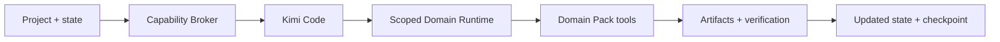

# Industrial Agent Harness

English · [简体中文](README.zh-CN.md)

[](#preview-scope)
[](LICENSE)
[](package.json)

**An AI workbench for engineering projects, with scoped tools and verifiable results.**

Industrial Agent Harness connects local projects, Kimi Code, professional software and engineering evidence through a desktop workbench. Domain Packs provide the knowledge, tools and verification methods for each field.

> [!IMPORTANT]
> **Developer Preview.** The project is a Workbench MVP with persistent, scoped engineering runtimes. APIs, Pack interfaces and runtime behavior are still evolving. This README describes the current source tree; published preview archives follow their own release notes.

[Quick start](#quick-start) · [Domain Packs](#domain-packs) · [Viewers](#viewers) · [Documentation](#documentation) · [License](#license)

## What you can do

- **Work from a real project.** Bind a local directory to a domain, keep multiple chats, resume sessions and inspect execution logs.
- **Start without a Domain Pack.** New projects default to the built-in General domain. Install specialized packs from the project dialog while keeping your folder and name; successful installation returns to the draft with the new domain selected. See [project onboarding](doc/project-onboarding.md).
- **Load relevant knowledge and tools.** The Capability Broker progressively discloses Skills and tool schemas, then enforces the selected scope at execution.
- **Use project guidance.** Discover `.skill/`, `.skills/` and standard project Skill directories, and load project `AGENTS.md` through Kimi's native mechanism. See the [compatibility audit](doc/kimi-native-compatibility-audit.md) for remaining limitations.
- **Keep engineering evidence.** Domain runtimes record inputs, actions, artifacts, verification and checkpoints. Input changes invalidate current evidence; interrupted work remains visible after restart.
- **Inspect artifacts in the workbench.** View waveforms, netlists, layouts, KiCad designs, Godot assets and ordinary project files.
- **Extend with Domain Packs.** Build independent Domain Packs with complete Skill resources and installation integrity checks.

Kimi Code owns the agent loop, conversation history and compaction. Harness supplies project context, scoped engineering tools and evidence. A completed agent turn or a successful process exit does not establish engineering acceptance.

The shared engineering execution path is:



## Quick start

Use **Node.js 24+** and **pnpm 11.1.3**. Kimi Code 2.1.1 is bundled; Agent execution needs model API settings. Installed Chip tools use the managed Harbor EDA image and need a running Docker daemon; no host Python or manual `uv sync` is required. Local Agents on macOS, Linux and Windows use the current user permissions without an Agent OS sandbox dependency; platform and Domain Pack qualification remain as listed in [preview scope](#preview-scope).

```sh
git clone https://github.com/Zhiman-BJ/industrial-agent-harness.git
cd industrial-agent-harness
npm install --global pnpm@11.1.3
pnpm install --frozen-lockfile
```

### 1. Start the desktop workbench

```sh
pnpm --filter @industrial-agent-harness/desktop setup:kimi
pnpm dev
```

On macOS, a restricted command environment may deny GUI service access before Electron reaches application code. The launcher now reports that denial before spawning Electron. Use `pnpm --filter @industrial-agent-harness/desktop gui:prepare` and open its generated development app from the desktop; see [startup and UI validation](doc/electron-macos-startup.md).

Open **Settings → Model API** to configure your model, then add a local project and select its domain. Open the right-hand workspace to browse files. File previews work without a model API key.

Select the server's **API format** independently of the Kimi agent kernel. Official MiniMax Chat Completions uses OpenAI-compatible settings; thinking controls vary by model and protocol. See [tested model API behavior and remaining gaps](doc/model-api-compatibility.md).

**The layout button** switches between the classic split view and a shared chat/file/Viewer tab strip. `+` browses project files; single-click reuses a preview tab, while double-click or the pin keeps it. Switching retains drafts and Viewer state. The window fits the display work area and uses tabs automatically when narrow. [Responsive layouts](doc/desktop-layouts.md).

**Settings → Language** switches between English, 简体中文 and Follow system immediately. The app remembers your preference; switching preserves drafts, running tasks and viewer state. Harness controls and dialogs are localized; project files, conversations, tool output and embedded third-party interfaces retain their original content. See [desktop languages](doc/desktop-languages.md).

The sidebar shows the green Core mark and Micius Harness on a separate row above Projects, aligned with the project section. Project navigation places each project name above its domain metadata. Settings groups appearance, agent configuration and application options without changing their existing actions. Escape or Close returns focus to Settings; clicking outside dismisses the popover without taking focus from the chosen control.

The setup command verifies the bundled **Kimi Code 2.1.1** runtime; Desktop uses the authenticated Server API integration. No separate Python Kimi installation is needed. See the [migration record](doc/kimi-code-migration.md) for history, diagnostics and compatibility. Layout viewing additionally needs KLayout Python: run `pnpm --filter @industrial-agent-harness/desktop setup:layout` or set `KLAYOUT_PYTHON`.

### 2. Maintainer native regression on macOS with Apple Silicon

This historical full-suite source entry includes compatibility tests that need host Verilator, a C++ toolchain, uv and Python 3.13. It is a maintainer workflow, separate from ordinary installed Chip use, which runs the prebuilt EDA image. The current managed and installed tests additionally require Docker:

```sh
brew install verilator
(cd "$(node scripts/pack-source.cjs chip-pack)/eda-harness" && uv sync --frozen --no-dev --python 3.13)
HARNESS_REQUIRE_CORE_NATIVE=1 pnpm run test:industrial-core
```

The tests run real RTL simulation and check assertions, waveforms, failure handling, installed Pack integrity and restart recovery. Model responses come from a controlled local provider, so these tests do not spend model API credits or measure model capability. See the [industrial runtime guide](doc/p0-industrial-runtime.md) for real-task setup and evidence boundaries.

The current managed Chip profile is qualified on macOS ARM64 and Linux x86-64 with Docker. The historical Linux [one-command installer](releases/chip-linux-installer-v0.1.0-preview.3.md) retains its own versioned runtime and installation instructions.

Prefer a packaged preview? Browse [GitHub Releases](https://github.com/Zhiman-BJ/industrial-agent-harness/releases) and follow that version's instructions. Existing archives do not acquire newer source features automatically.

Current source consumes **Domain Packs 0.7.0** at owner commit `1eae41d583bc526c36ae8a8f6c08343504949928`. Installing a Pack installs its trusted capabilities, Skills and adapters; native dependencies are installed externally; container preparation and remote configuration are separate actions. In the capability center or project details, choose a qualified native, container or remote profile, associate compatible existing software, or explicitly prepare a container image after installing and starting Docker. Native profiles have no Harness download/install action. Native FreeCAD, Godot and the isolated DXF runtime do not require Docker; Docker remains necessary for Chip, PCB design and DXF container profiles. The product catalog offers four domains: Chip, PCB, Godot and CAD. CUDA is withdrawn from fresh and legacy installed product entries; its standalone implementation remains available. Domain cards use clear borders, a one-line purpose and collapsed requirements; status names actual missing dependencies. Green means ready, yellow means missing, red means check failure and neutral means unchecked. The latest failed check overrides saved Ready in the display. The Go platform component performs fixed environment detection, not a full domain MCP rewrite. See [distribution v2](doc/runtime-distribution-v2.md), [installation experience](doc/install-experience.md) and [current acceptance evidence](doc/qa-runtime-distribution-v2-20261012.md). Model configuration, environment readiness and engineering verification remain separate. This source change does not establish a signed public installer, Core OTA, new Mac CI runner or broader native qualification.

**Historical local candidate:** the 1.0.1-beta.1 Apple Silicon desktop candidate lists all five domains. Chip, PCB, Godot and CAD are optional bundled Packs, including when no online catalog is configured; CUDA stays visible with its remote prerequisites and unavailable desktop-package status. Selecting PCB, Godot or CAD automatically prepares the pinned official KiCad 10.0.6, Godot 4.7.2 or FreeCAD 1.1.4 in the user Pack store. These managed tools need no shell commands or environment setup; Chip still needs its external Python, compiler and EDA/PDK environment. Core bundles Kimi Code 2.1.1; model API configuration remains separate. The installer shows size estimates, progress, cancellation and recovery, then each domain’s actual readiness. See [installation experience and release limits](doc/install-experience.md) and [CAD installation acceptance](doc/macos-cad-distribution.md). This local candidate is not a signed public release or a qualified Core OTA update.

## Domain Packs

| Domain                                                                            | Current 0.7.0 capability                                                                                                                                                     | Dependencies and qualified scope                                                                                                                                                                                                                          |
| --------------------------------------------------------------------------------- | ---------------------------------------------------------------------------------------------------------------------------------------------------------------------------- | --------------------------------------------------------------------------------------------------------------------------------------------------------------------------------------------------------------------------------------------------------- |
| [Chip](https://github.com/Zhiman-BJ/industrial-domain-packs/tree/main/packs/chip) | Managed EDA operations, RTL assertions and VCD, Yosys synthesis checks, waveform/netlist/layout viewing                                                                      | macOS ARM64 and Linux x86-64 with Docker; prebuilt Harbor image includes Python and tools. Physical flows still need project-owned PDK/technology inputs. Synthesis is not equivalence, LVS or physical signoff.                                          |
| [PCB](doc/pcb-godot-runtime.md)                                                   | Reused PCBbench design tools and Skills for user-owned schematic/board creation, repair, components, checks and exports; ordinary projects need no benchmark seed or scoring | macOS ARM64; bounded native board operations use compatible KiCad 10.0.6; broader PCB design uses the pinned Docker gateway. Actual ERC/DRC and applicable analyses remain separate evidence; no blanket electrical, compliance or manufacturing signoff. |
| [CAD · FreeCAD / DXF](doc/freecad-domain-pack.md)                                 | Parametric FreeCAD creation/edits, FCStd/STEP/STL export and geometry readback; bounded DXF creation/inspection/verification                                                 | macOS ARM64; native FreeCAD 1.1.4, the isolated native DXF runtime and the pinned ezdxf Docker runtime are separate profiles. AutoCAD is optional. DXF covers declared 2D geometry; no general DWG/PDF conversion, strength or manufacturing acceptance.  |
| [Godot](doc/pcb-godot-runtime.md)                                                 | Typed scene transforms/BoxMesh edits, native import/readback/frame verification; source and Web Export viewers                                                               | macOS ARM64; associate compatible Godot 4.7.2 installed externally. Qualification covers explicit structural properties, not unrestricted gameplay QA; Web Export retains separate dependencies.                                                          |

The shared environment layer supports externally prepared CLI files and isolated runtime directories, with fixed probes and full tree integrity. Pack installation never implicitly prepares dependencies. Installed native DXF passed canonical geometry, negative verification, failure, cancellation/reopen, tree tamper rejection and external repair (43 seconds), without Docker. Installed physical PCB passed ERC, DRC with zero errors, truthful overall UNKNOWN, cancellation and reopen (25 seconds); 88 tool fixture dispatch checks are separate evidence. Chip and full PCB design native execution remain unqualified. Historical KiCad download/resume evidence covers a retired product path, not a current acceptance blocker. Packs declare source/evidence boundaries; the shared backend owns persistent tool sessions, cancellation and cleanup. Platform qualification is specific to each row, not implied by installing a source Pack.

Build your own Pack with the [Pack authoring tutorial](doc/pack-authoring.md). Domain code lives in Packs; the shared Core and Broker remain independent of concrete domains. Registration, a rendered preview or a successful native smoke check does not imply a complete industrial workflow. The [PCB/Godot native profiles](doc/pcb-godot-runtime.md) and owner qualification records describe exercised tasks; broader engineering support remains outside those records. The [earlier release audit](doc/release-readiness-20261007.md) is historical evidence.

### Task results

Tools register compact result rows automatically through the shared task service, with attached reports grouped under Supporting results and file/check details expanded on demand. Open the main result, inspect native files/exports, and read checks for the recorded version. Explicit replacements preserve history; parallel designs stay visible. One supported read-only preview can open once after a foreground request settles, provided you have not changed files/tabs/chats. History, background work, failures and ambiguous choices never take focus. Partial outputs and changed files are labeled. Agent `select_result` is optional. FreeCAD generation → consecutive edits → checks → cards → OCCT viewing was exercised on macOS arm64 from source, separately from a real-model demonstration; no new installer/platform qualification. [Behavior, contract and evidence](doc/task-results.md).

Reading chat history requires no execution setup, including for unfinished remote projects. Saved result events read existing facts without loading Packs, and share file validation within that read; later reads and file opening recheck content.

The owner maintains [proposed declarations and an expansion plan for all five domains and six Packs](https://github.com/Zhiman-BJ/industrial-domain-packs/blob/cf72a46b6b4ba927b091ded71b2d52d227db0351/docs/result-presentation-plan.md). Only FreeCAD's domain producer is connected to task results today; the other result integrations remain planned. CUDA is withdrawn from the current product catalog; historical support remains in standalone sources.

## Viewers

Viewers open from the active project's file tree. They share zoom, Fit and fullscreen controls and leave source files and verification results unchanged. Drag the workspace divider or use its arrow/Home/End keys to resize the panels; double-click to reset. OCCT retains model proportions during resizing and fullscreen. [Local release acceptance](doc/release-readiness-20261007.md).

Harness-owned Viewer controls follow **Settings → Language** (English / 简体中文). Switching keeps zoom, selection and other view state; embedded upstream interfaces keep their own language. Languages and Desktop/Viewer translations share one [configuration](apps/desktop/i18n.config.json); see [language scope and maintenance](doc/desktop-languages.md).

| Viewer                                               | Inputs                                                                                                       | Viewing features and limits                                                                                                                                                                                                                                                                                                                                                                                                                                                                                                                                                                                 |
| ---------------------------------------------------- | ------------------------------------------------------------------------------------------------------------ | ----------------------------------------------------------------------------------------------------------------------------------------------------------------------------------------------------------------------------------------------------------------------------------------------------------------------------------------------------------------------------------------------------------------------------------------------------------------------------------------------------------------------------------------------------------------------------------------------------------- |
| [Chip layout](doc/viewer-eda-reference.md)           | GDS/GDSII, OAS/OASIS                                                                                         | Viewport rendering and layer selection; requires KLayout Python.                                                                                                                                                                                                                                                                                                                                                                                                                                                                                                                                            |
| [Netlist](doc/viewer-eda-reference.md)               | Yosys `write_json` output                                                                                    | netlistsvg diagrams in a worker; ordinary JSON uses the document viewer.                                                                                                                                                                                                                                                                                                                                                                                                                                                                                                                                    |
| [Waveform](doc/viewer-eda-reference.md)              | VCD, FST, GHW                                                                                                | Signal and timeline inspection with bundled Surfer WASM.                                                                                                                                                                                                                                                                                                                                                                                                                                                                                                                                                    |
| [KiCad](doc/kicad-viewer.md)                         | `.kicad_pcb`, `.kicad_sch` and project subsheets                                                             | Local KiCanvas 2D and PCB 3D from the same source: layers, separation, source picking, STEP/static WRL bodies and shared navigation. Local models take priority; explicit downloads use the pinned official STEP catalog and host cache. No automatic WRL-to-STEP substitution, placeholders or KiCad installation. Incomplete previews are reported. See [PCB 3D](doc/pcb-3d-viewer.md).                                                                                                                                                                                                                   |
| [Godot Web Export](doc/godot-viewer.md)              | Matching HTML/JS/WASM/PCK files                                                                              | Run, pause, step and inspect scene nodes; requires a single-threaded export with the Viewer Bridge.                                                                                                                                                                                                                                                                                                                                                                                                                                                                                                         |
| [Images and sprites](doc/godot-assets-viewers.md)    | PNG/JPEG/WebP; `.sprite.json` plus images                                                                    | Pan, sampling modes, atlas selection and cropping previews; no Godot runtime required.                                                                                                                                                                                                                                                                                                                                                                                                                                                                                                                      |
| [Animation](doc/godot-assets-viewers.md)             | Supported `.tres`/`.tscn` and atlas animations                                                               | Playback and frame stepping for bounded SpriteFrames/Sprite2D formats; does not run the Godot engine.                                                                                                                                                                                                                                                                                                                                                                                                                                                                                                       |
| [Engineering files](doc/engineering-file-viewers.md) | Godot scenes/resources/scripts; KiCad libraries/rules; Gerber/drill; STEP/VRML and selected 3D/audio formats | Structured, manufacturing-layer and media previews; limited geometry and semantics, not an editor or manufacturing acceptance.                                                                                                                                                                                                                                                                                                                                                                                                                                                                              |
| [CAD · OCCT](doc/freecad-domain-pack.md)             | STL; Pack-generated FCStd/STEP with hash-checked BREP/STL and optional native sketch companions              | Official OCCT 7.9.2 AIS/V3d WebGL2: shaded faces, CAD edges, X/Y/Z capped sections, an explicit Measure button for face/edge picking and BREP length/diameter/area/minimum-distance annotations directly on the model (separate single-object size and two-object minimum-distance modes, without a measurement sidebar); native sketch geometry, dimensions and constraint highlighting. Shared navigation/fullscreen with stable proportions on resize; local WASM, WebGL2 required. Read-only, nominal geometry measurements without tolerance or engineering acceptance. macOS arm64 Electron verified. |
| [Documents](doc/document-viewers.md)                 | CSV/TSV, JSON, JSONL/NDJSON, Markdown, TXT/LOG                                                               | Tables, structures, record browsing and text search; bounded UTF-8 input, no formulas or embedded HTML execution.                                                                                                                                                                                                                                                                                                                                                                                                                                                                                           |

Remote CAD receipts also open through this Viewer: a bounded artifact index resolves FCStd/STEP companions by verified SHA-256 without changing the downloaded bytes. Real remote build, desktop viewing and automatic sandbox release are recorded in [CAD remote acceptance](doc/evidence/remote-cad-20261019/README.md).

KLayout Python remains a local Viewer prerequisite; connecting its declaration, readiness and resolution to the shared dependency manager is still TODO. The development setup command does not establish managed dependency support. See [macOS source startup and Viewer dependencies](doc/electron-macos-startup.md).

Exact format lists, file limits and rendering dependencies are documented in the linked guides. New Viewer integrations must update both language READMEs and follow the [Viewer integration contract](AGENTS.md#viewer-integration-contract).

Try the [Sobel chip project](examples/chip-sobel/README.md), [LED board](examples/pcb-led/README.md), [Godot playground](examples/godot-viewer/README.md) or [document samples](examples/document-viewers/README.md). These are viewing examples; Godot Web Export must be generated separately. They are not engineering acceptance evidence.

## Documentation

| Start here                                                                                   | Details                                                                                                                             |
| -------------------------------------------------------------------------------------------- | ----------------------------------------------------------------------------------------------------------------------------------- |
| [Documentation index](doc/README.md)                                                         | Architecture, product decisions and module guides; most detailed documentation is currently in Chinese.                             |
| [Pack authoring](doc/pack-authoring.md) · [Versioned contracts](doc/contracts-versioning.md) | Independent Pack development, resources, compatibility and canonical industrial facts.                                              |
| [Current delivery and validation](doc/harness-quality-three-tracks.md)                       | Implemented scope, exercised tests and remaining work. Historical architecture proposals are not implementation claims.             |
| [Paired evaluation baseline](doc/benchmark-baseline.md)                                      | Native Kimi/Harness comparison, frozen inputs and independent verification. Formal model success-rate and cost results are pending. |
| [Security](SECURITY.md) · [Third-party notices](THIRD_PARTY_NOTICES.md)                      | Execution boundaries, reporting and component provenance.                                                                           |

## Development and contributions

Issues and pull requests are welcome. Include the source commit, platform, affected domain, a minimal reproduction and redacted logs. For code changes, read [AGENTS.md](AGENTS.md), keep domain behavior inside Packs and verify the relevant real execution path.

```sh
pnpm run test
pnpm run test:architecture
pnpm run test:release
pnpm run format:check
```

The [Harness CI gate](.github/workflows/ci.yml) runs shared-package and packaged CLI regressions on Linux x64/arm64, macOS arm64 and Windows x64, desktop installation on macOS/Windows, and declares industrial Core acceptance lanes for Apple Silicon and Linux x86-64, including the actual installed Chip CLI. The container-backed Mac lanes currently require a suitable runner with local Docker; local acceptance does not mean those GitHub-hosted lanes are passing. [CI regression coverage](doc/ci-regression.md) documents dependencies, retained evidence and explicit coverage gaps; a skipped test does not establish support. Report security issues through the process in [SECURITY.md](SECURITY.md).

## Preview scope

- **Platforms:** desktop build and first-run CI targets are macOS with Apple Silicon (arm64) and Windows x64. Intel Mac is temporarily unsupported; no Intel installers or Pack catalog targets will be published. Support can resume after installation and runtime validation on an Intel test machine. Signed installers and real upgrades still need separate acceptance.
- **Local Agent permissions:** macOS, Linux and Windows use the current user permissions, without an Agent OS sandbox or optional strict mode. Native Bash, file tools and descendants can modify files accessible to that user. Broker, approval and Runtime checks, declared local-task isolation and remote tenant isolation remain. This policy change does not expand platform or packaged qualification. See [local Agent execution](doc/local-agent-execution.md).
- **Tool compatibility:** all domains have approved workspace edits and declared task execution. Registered external MCP uses audited host Runtime calls; removing Agent OS isolation does not authorize new tools or qualify legacy Domain MCP workflows. The separate Computer Use plugin remains unavailable.
- **Engineering acceptance:** declared domain profiles verify specific native checks and retain failed or missing evidence. RTL coverage sufficiency, physical signoff and complete industrial workflows are not implied.
- **Packaging and evaluation:** local unsigned desktop checks and controlled model fixtures are documented. Signed releases, end-to-end cross-platform qualification and formal paid model comparisons remain separate work.

See the [validation record](doc/harness-quality-three-tracks.md) for exact tested versions and results.

## License

Project-owned contributions are licensed under the **[MIT License](LICENSE)**, including the authorized EDA Harness and EDA Harness demo code.

Bundled renderers, fonts, dependencies and separately installed tools retain their own licenses. The complete distribution is not MIT-only; consult [THIRD_PARTY_NOTICES.md](THIRD_PARTY_NOTICES.md) and the relevant provenance records. External private PCB resources are not granted a public license by this repository.

Shared initialization, editing, declared local/Docker tasks and external MCP are documented in [Shared workspace](doc/shared-workspace.md). Packaged consumer CI exercises empty-project creation, failing checks and repair; specialized tools, models and sign-off remain Pack/project responsibilities.

Workspace approvals show file diffs, declared commands and external arguments. `doctor` checks execution prerequisites without a model; workspace selection and explicit local dependency roots are described in [Shared workspace](doc/shared-workspace.md). External MCP preserves connection state within the current chat process and fails visibly if that state is lost.

### Built-in remote execution (internal trial)

Remote execution now uses the session-based Gateway v1.1: Kimi/Agent stays local, while the remote service supplies domain MCP, professional software and sandbox execution. Desktop and CLI share persistent chat bindings, explicit immutable file uploads, canonical evidence import and verified artifact downloads that never overwrite existing files. Changed local files require another upload review; stopping the local wait does not cancel remote computation. Connection readiness and qualified software/worker execution remain separate. Explicit rebind creates a new remote project while retaining the old binding history; it does not migrate old 0.2 jobs or engineering facts. Public endpoint/sign-in defaults remain unset, and this refactor does not qualify KiCad or a production Linux worker. Historical H200 RTL checks apply to the previous protocol. See [remote execution and CLI commands](doc/remote-execution.md).

The desktop chat combines remote and task state in a collapsible execution card. Chat columns at least 960 px wide reserve a side gutter; narrower columns keep the card above messages with bounded scrolling. Task progress, pending work and remote failures have distinct summaries; project/settings pages retain background polling without showing the card. When remote readiness blocks input, the composer explains the blocker and links to project execution settings; a missing Kimi runtime keeps its higher-priority hint. These presentation changes preserve upload confirmation, task approvals and the existing readiness gate.

Local Computer Use acceptance on 2026-10-16 exercised the sidebar and Settings interactions, upload review, readiness gating, HTTP 503 recovery, session termination, source-file preview and narrow split-view controls. Remote checks used a loopback UI fixture with `engineeringExecution: false`; they did not run a real model, EDA tool or the automated native UI selftest suite. See [PD-081](doc/product-decisions.md#pd-081聊天执行状态卡的层级与窄栏适配) for the verified scope and test limitations.

To start the controlled fixture from the repository root:

```sh
MOCK_REMOTE_TOKEN=mock-token node scripts/remote-ui-fixture.cjs
```

Launch the test client with `INDUSTRIAL_REMOTE_SERVICE_URL=http://127.0.0.1:8787`, `INDUSTRIAL_REMOTE_CREDENTIAL_ENV=MOCK_REMOTE_TOKEN` and the same `MOCK_REMOTE_TOKEN`. File upload still requires explicit review and confirmation. This fixture establishes UI protocol behavior only, not production remote execution or engineering qualification.

The Harness task application is shared across Desktop and the internal headless surface; domain metadata, Skills and implementations come from one immutable Domain Packs release. See [consumer migration and validation](doc/shared-task-and-pack-consumption.md).

The preceding managed release pinned Domain Packs 0.6.0 by immutable commit and prepared the declared Harbor assets through the generic Pack Manager. Its historical evidence follows. macOS ARM64 qualification covers the declared CAD, PCB and Godot profiles and the CUDA remote client; managed Chip also passed Linux x86-64 installation and native checks. See [installation evidence](doc/install-experience.md) and each domain's qualification limits. Historical preview archives retain their original dependencies and scope.
