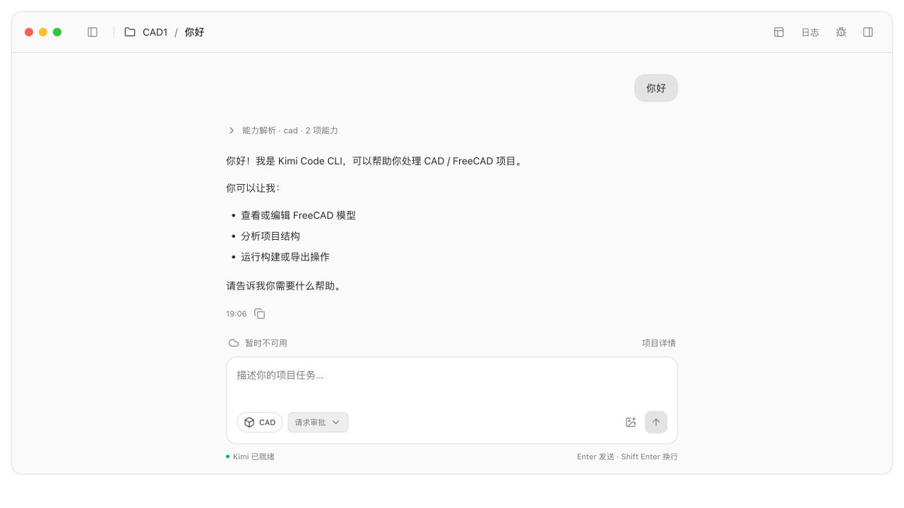
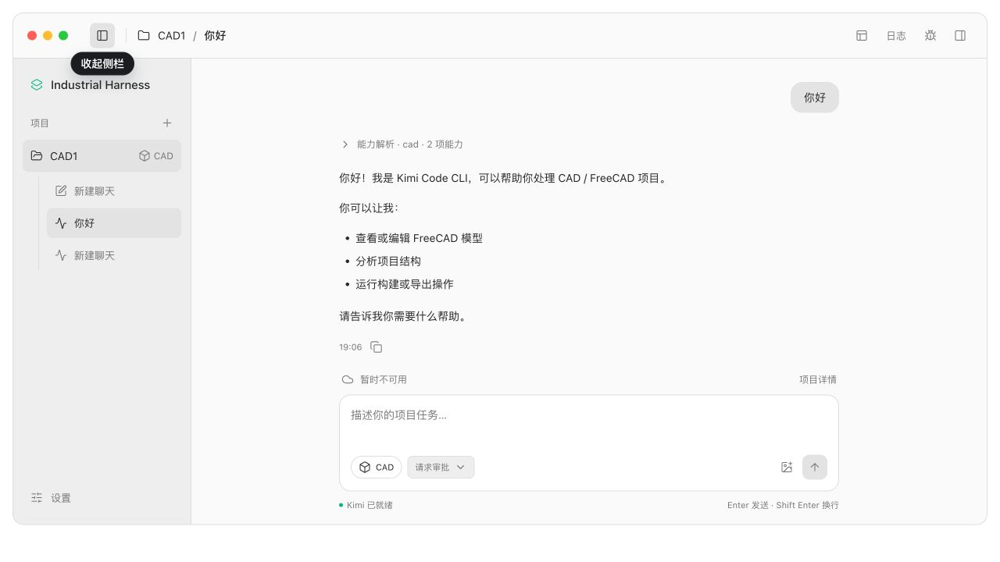
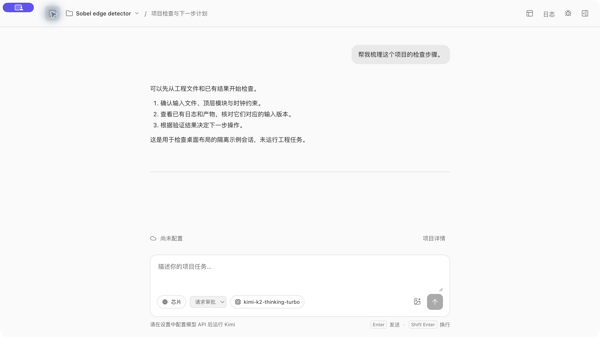
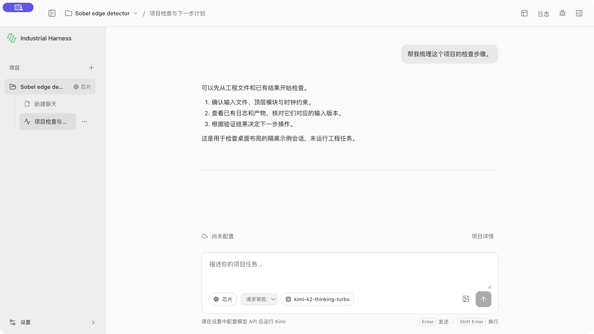

# 桌面统一顶栏与输入区对齐实施方案

日期：2026-10-16。状态：已实现，macOS 布局与状态回归通过；完整验收仍有下文列出的未通过和待验证项。

跟踪 Issue：[桌面侧栏收起后的顶栏布局与输入区对齐 #212](https://github.com/Zhiman-BJ/industrial-agent-harness/issues/212)。

采用“统一顶栏＋输入区对齐”的局部桌面外壳调整，解决侧栏收起后窗口控制区拥挤、展开按钮移位、当前聊天标题缺失，以及运行状态提示与输入框脱节的问题。目标是在真实桌面应用中达到下方两张示意图的布局效果，并保留现有聊天、文件工作区与 Viewer 的使用状态。

本方案只调整 Desktop 展示与导航，遵守 [IH-ARCH-001](architecture-contract.md)。现有任务 API、Broker、Kimi、Domain Runtime 和工程事实契约不在本次修改范围内。预计约 1 个工程日；出现布局或原生窗口回归问题时，预留到第 2 天。

## 目标效果

全局顶栏横跨窗口，侧栏开关固定在窗口控制区旁。侧栏从顶栏下方展开，产品名称和项目导航完整显示。正文、运行状态提示、输入框和底部说明使用统一宽度与左右边界。

以下是布局示意，尚不是修改后的应用截图。真实品牌 Logo、消息内容、审批入口和现有操作按钮继续保留；示意图中简化的内容不作为删减功能的依据。

### 侧栏收起

窗口控制区、展开按钮和“项目名 / 聊天名”始终可见，聊天内容在可用面板内居中。



### 侧栏展开

开关及标题位置保持不变，侧栏在顶栏下方展开，设置保留在侧栏左下方。



### 尺寸基准

尺寸均为桌面逻辑像素，不按 Retina 截图的物理像素计算。

| 项目 | 修改前普通桌面布局 | 本次实现 |
| --- | --- | --- |
| 全局顶栏 | 顶部功能分散，既有标题栏高度 48px | 独立全局顶栏，高度 58px |
| 展开侧栏 | 宽度 256px，占据窗口左上角 | 宽度 228px，从全局顶栏下方开始 |
| 聊天正文与输入区 | 最大宽度 680px | 最大宽度 640px，共享水平留白 |
| 侧栏开关 | 分布于侧栏、聊天顶栏及标签栏 | 一个主开关，收起与展开前后位置固定 |
| 运行状态提示 | 独立宽度与内边距 | 与输入框、底部说明共用内容边界 |

窄窗口按可用空间缩小内容宽度，不强制占满 640px。为避免影响 Viewer 和弹窗等局部工具栏，全局顶栏使用独立尺寸变量，不直接把所有共用 `--ia-header-height` 的控件一起改成 58px。

[DESIGN.md](../apps/desktop/DESIGN.md) 已同步新尺寸；[PD-080](product-decisions.md#pd-080统一桌面顶栏与聊天内容边界) 替代 PD-061 的旧外壳尺寸与入口分布，保留旧决策中的主题与交互约定。

## 实施范围与文件

| 文件 | 计划修改 |
| --- | --- |
| [App.tsx](../apps/desktop/src/App.tsx) | 将顶栏放到侧栏和工作台的共同上方，连接现有状态与事件，移除重复入口 |
| `apps/desktop/src/components/DesktopHeader.tsx`（新增） | 集中展示窗口控制区、侧栏开关、项目和当前位置及已有操作按钮 |
| [style.css](../apps/desktop/src/style.css) | 统一外壳尺寸、拖动区域、面板边界、抽屉位置和聊天内容对齐 |
| [CapabilityCenter.tsx](../apps/desktop/src/components/CapabilityCenter.tsx) | 去掉重复的窗口控制按钮，保留页面返回和局部导航 |
| [WindowControls.tsx](../apps/desktop/src/components/WindowControls.tsx) | 由全局顶栏统一复用，维持现有 IPC 和平台行为 |
| [main.cjs](../apps/desktop/electron/main.cjs) | 更新其中旧测试选择器；仅在原生红黄绿垂直对齐需要时调整 `trafficLightPosition` |
| [ui-selftest.cjs](../apps/desktop/electron/ui-selftest.cjs) 及受影响的既有 selftest | 增加几何位置和状态保留断言，迁移旧顶栏选择器 |
| [DESIGN.md](../apps/desktop/DESIGN.md)、[桌面布局文档](desktop-layouts.md)、[产品决策记录](product-decisions.md) | 在落地时记录新尺寸、可观察行为和实际验证范围 |

其他文件仅在直接依赖上述布局或选择器时调整。不新增布局偏好、不引入 UI 框架、不扩展窗口管理 IPC，不修改架构检查器、CI 工作流或例外清单。

## 实施步骤

### 一 统一全局顶栏

将全局顶栏放到 `.ia-columns` 之前，外壳改为纵向布局，下面的侧栏和工作台填满剩余高度。聊天和 Viewer 继续共用现有挂载路径。

```text
Desktop shell
├─ DesktopHeader
│  ├─ 平台窗口控制区与侧栏开关
│  ├─ 项目与当前位置
│  └─ 现有布局、日志、调试和工作区操作
└─ Content columns
   ├─ Project sidebar
   └─ Workbench
      ├─ 文件与聊天标签栏（标签页模式）
      └─ 现有聊天及 Viewer 内容
```

顶栏展示模块消费现有页面与项目状态，不持有另一套聊天或布局状态。侧栏开关继续调用现有 `leftOpen`、`compactSidebarOpen` 对应的操作。

- 聊天页显示“项目名 / 聊天名”，聊天标题复用现有格式化规则与缺省名称。
- 项目详情页显示当前项目及页面名称；能力中心显示对应位置，并保留返回操作。
- 标签页激活文件时显示当前项目和文件；聊天运行、审批和提问提示继续保留在原有标签中。
- 删除侧栏品牌行、旧聊天顶栏和标签栏内重复的主侧栏开关；标签栏负责标签导航，Viewer 工具栏负责缩放、Fit、文件及全屏操作。

macOS 保留原生红黄绿，在全局顶栏中预留其占用空间。其他平台在全局顶栏中保留一组自绘 `WindowControls`。全局顶栏的空白区域可拖动窗口，按钮、输入和可操作标签设为 `no-drag`，避免拖动区域吞掉点击。

### 二 调整侧栏与外壳样式

侧栏品牌行移到顶栏下方，使用真实 Logo 和完整产品名称。按 228px 宽度整理项目与聊天列表，设置继续固定在侧栏底部。

统一全局顶栏与内容区域的分隔线、背景和圆角，去掉旧聊天面板顶部不再合适的独立圆角及边框。外层和剩余内容区明确设置伸缩关系及 `min-height: 0`，避免新增顶栏后出现窗口整体滚动或底部输入区溢出。

移除侧栏品牌行与 `.ia-workbench-tabbar.ia-lights-gap` 的旧窗口按钮避让规则，避免重复预留。全局顶栏和 Viewer 工具栏分别管理自己的高度。

### 三 统一正文和输入区对齐

为正文、运行状态提示、输入框及底部说明建立共同的内容宽度与边距变量。正文和输入区最大宽度为 640px，在聊天面板内居中；“暂时不可用／项目详情”与输入框边界一致。

优先通过共享样式完成对齐，保持 `RemoteTaskStatus`、textarea、附件和 Viewer 的挂载关系稳定。同步处理消息刻度栏占用的留白，避免只有正文向右偏移，或刻度与文字重叠。

保留空白聊天的欢迎布局、已有消息时的底部输入位置，以及设置提示、Todo、错误、远程状态和附件等实际内容。对齐验收使用这些真实状态，不用空白样例代替。

### 四 补齐响应式与页面兼容

继续使用现有断点：内容宽度小于 900px 自动采用标签页，小于 760px 使用侧栏抽屉；恢复宽度后仍遵循原有布局偏好。

- 抽屉和遮罩从全局顶栏下方开始，不能挡住主侧栏开关。
- 长项目名、聊天名和文件名省略显示，完整名称通过可访问名称或提示保留。
- 控件随宽度合理压缩，现有操作保持可达，不遮住窗口控制区。
- 能力中心只保留局部返回和导航，避免出现第二组窗口控制按钮。
- Viewer 全屏根仍为现有 workspace，保留缩放、Fit、退出按钮和 Esc；退出后恢复原布局及同一 Viewer。

### 五 迁移测试与完成真实应用对照

将依赖 `.ia-chat-header b`、`.ia-sidebar-brand .ia-icon`、标签栏侧栏按钮和 `.ia-chat-actions button:last-child` 的测试，改为明确、稳定的项目标题及操作选择器。包括 `main.cjs` 中内嵌的 selftest 调用，不只更新 `ui-selftest.cjs`。

侧栏抽屉遮罩也可能使用“收起侧栏”的可访问名称；主开关唯一性检查需定位全局顶栏内的开关，不能简单统计所有同名按钮。

## 验证与验收

### 必须通过的行为检查

| 验收项 | 通过标准 |
| --- | --- |
| 顶栏与侧栏尺寸 | 普通桌面状态符合 58px 顶栏、228px 侧栏基准 |
| 固定侧栏开关 | 同一窗口尺寸下收起与展开前后位置变化不超过 1px |
| 窗口按钮避让 | macOS 原生红黄绿与应用控件无重叠，点击和窗口拖动正常 |
| 单一入口 | 全局顶栏只有一个主侧栏开关；非 macOS 普通窗口只有一组自绘窗控 |
| 页面上下文 | 标题来自当前项目、聊天或文件状态，切换后不残留旧标题 |
| 内容对齐 | 宽窗口正文与输入区共同限宽 640px；状态提示、输入框和底部说明外边界一致 |
| 聊天连续性 | 切换侧栏和布局后 textarea 节点、草稿、附件及阅读位置保留 |
| Viewer 连续性 | 当前文件、Viewer 节点和查看状态保留；全屏及 Esc 正常 |
| 最小窗口 | 640×480 下关键操作可见、可达，抽屉不覆盖顶栏，无窗口横向溢出 |
| 主题与语言 | 深浅主题、中英文、长标题均无重叠和不可读内容 |

滚动位置检查使用不会触发布局重排的稳定内容；会因宽度变化重新换行的长消息，应同时检查阅读锚点，避免只追求相同 `scrollTop` 数值而导致可见内容跳动。

### 复用现有测试

先执行构建和架构门禁：

```bash
pnpm build
pnpm test:architecture-contract
pnpm test:architecture
```

扩展并执行现有桌面回归：

```bash
pnpm --filter @industrial-agent-harness/desktop test:ui
pnpm --filter @industrial-agent-harness/desktop test:language
pnpm --filter @industrial-agent-harness/desktop test:parallel
pnpm --filter @industrial-agent-harness/desktop test:cad-resize
```

`test:ui` 已覆盖多种窗口尺寸、主题、语言、标签、草稿与 DOM 保留，在现有场景中加入侧栏切换即可。`test:cad-resize` 用于验证真实 CAD canvas、相机、比例和全屏行为。被修改选择器的其他 selftest 需通过对应既有门禁；保持既有架构与集成检查，不以纯样式测试替代真实路径验证。

使用 `INDUSTRIAL_UI_SCREENSHOTS` 指定 UI selftest 截图目录，保留与本次构建对应的验证图片。测试通过后，仅在出现新改动、新失败或未解决问题时扩大或重复验证。

### 真实桌面截图对照

从本次代码构建并启动测试应用，核实当前运行的是本次构建。在相同内容视口、显示缩放、主题和会话状态下分别截图，交付“收起侧栏”和“展开侧栏”两张真实成品图。

对照时排除示意图外层的预览留白，核对顶栏高度、按钮位置、侧栏宽度、品牌名称和输入区对齐。示意图中的消息和占位图标不做逐像素匹配，原生窗口按钮按实际平台显示。

macOS 验收必须包含原生红黄绿的窗口截图；`webContents.capturePage()` 仅有页面内容，不能单独证明原生控件避让正确。复用现有 1440×900、1250×800、1000×650、800×600 和 640×480 场景检查适配。Windows 以对应 CI 运行记录为准，未执行的平台不标为已验证。

## 交付与完成标准

1. 一个范围明确的桌面布局改动，移除旧重复入口及失效样式。
2. 相关构建、架构门禁、桌面回归和既有集成门禁的结果记录。
3. 同一窗口条件下的两张真实 macOS 成品截图，以及实际执行的其他平台验证记录。
4. 更新设计规范、桌面布局说明和产品决策记录，注明实施日期、可观察行为及验证范围。

只有真实应用达到两张示意图的布局目标，且状态保留和窗口适配验收通过，才将本方案标记为已完成。静态示意、构建成功或单个 CSS 修复都不单独构成完成。

## 实施与验收记录

2026-10-16，在 `codex/fix-212-desktop-shell` 分支实现。验证对象为基于 `2c3c2fe7ee8572f742e8d579ba15b571e48d3389` 的当前工作区，平台为 macOS arm64，Node v24.22.0、Electron 44.0.0。此处记录本地源码构建与验证，不代表已发布安装包；PR 门禁按仓库现行核心／完整验收分层执行。

### 已实现行为

新增纯展示组件 `DesktopHeader`，在 `.ia-columns` 上方提供 58px 全局顶栏，移除旧侧栏、聊天与标签栏中的重复入口；非 macOS 的 `WindowControls` 只由全局顶栏持有。macOS 保留原有 `trafficLightPosition: { x: 20, y: 18 }`，顶栏预留 96px 原生窗控空间。

侧栏宽度为 228px。聊天正文通过稳定的内层容器与状态、输入区、底部说明共享 640px 最大宽度，避免有实体滚动条时正文单独偏移。窄分屏输入区底部允许换行；窗口恢复到 760px 及以上后清除抽屉状态，后续缩窄不会意外展开抽屉。任务与 Viewer 生命周期沿用原实现。

同步更新了设计规范、桌面 README、根目录双语 README、布局文档及 PD-080。没有修改共享任务 API、领域实现、架构策略或检查器。

### 本次构建的真实截图

以下两张来自本次 `dist` 构建的原生 Electron 窗口，内容视口均为 1280×720 逻辑像素、Retina 2×、浅色主题、中文和同一隔离示例会话。示例会话用于布局检查，未运行工程任务。图片没有重绘窗口控件。

电脑控制工具启用后，系统会在左上角显示紫色控制提示，覆盖红黄绿区域；该提示不是 Harness 界面。两张截图用于对照展开／收起布局，原生窗控的独立截图见后文。





另一次启动在电脑控制工具操作前，留存了[包含原生红黄绿的窗口截图](images/desktop-shell-native-controls.png)。该图为同尺寸、英文界面，确认原生按钮与固定侧栏开关之间有可见间距。通过原生快捷键和窗口恢复操作实际记录了 `minimize`、`restore` 事件；证据为 `manual-native.log`。

原生红黄绿的鼠标点击和顶栏拖动尚未获得有效验证：工具操作后出现系统覆盖提示，点击未产生可确认结果，拖动也未产生窗口位置变化事件。因此不将这两项标为通过，合并前仍需在无控制覆盖提示的原生窗口中复核。页面截图和 CSS 拖动区域声明不能替代该项验收。

### 测试结果

日志与额外截图保存在 `dist/ci-reports/20261016-shell-212-2c3c2fe7/`（本机证据，gitignored），汇总见该目录的 `summary.json`。

| 检查 | 结果与证据 |
| --- | --- |
| `pnpm build`、`format:check` | 通过；`build.log`、`format-final.log` |
| `test:architecture-contract`、`test:architecture` | 分别 20、48 项通过；`architecture-contract.log`、`architecture.log` |
| `test:release`、`lint` | 17 项发行检查通过；lint 0 errors、94 warnings；`release.log`、`lint-final.log` |
| Portable、package smoke | 619 项通过、1 项在允许清单内跳过；独立包冒烟通过；`portable.json`、`portable.log`、`packages.log` |
| `test:ui`、`test:language`、`test:parallel` | 通过；覆盖尺寸、唯一入口、标题、宽度对齐、主题语言、640×480、草稿／附件／节点与阅读锚点保留；`ui.log`、`language.log`、`parallel.log`、`ui/` |
| `test:cad-resize` | 真实 FreeCAD／OCCT 通过；同一 canvas、相机、比例、全屏／Esc、侧栏切换，以及 280px 聊天分屏的中英文控件可达；`cad-resize.log` |
| 其他受影响桌面回归 | `chats`、`images`、`logs`、`messages`、`browser`、`documents`、`engineering`、`kicad`、`results` 全部通过；对应同名日志 |
| `test:godot` | **blocked**：缺少 Godot 4.7.2 的 Web export templates；尝试使用本机 Godot 导出后确认缺少 `web_nothreads_debug.zip`／`web_nothreads_release.zip`；`godot.log`、`godot-export.log` |
| `test:industrial-core` | **blocked**：缺少 Verilator。隔离环境补齐锁定的 Pack Python 后，原 Broker scope 拒绝消失，9 项中 2 通过、7 失败；未达到真实编译验收；`industrial-core-eda-ready.log`、`industrial-core-environment-summary.json` |
| `--viewer-selftest` 旧聚合入口 | **fail**：在到达本次迁移选择器之前，旧断言把资源列表首项当作 `chip.netlist.inspect`，但当前首项为 `project.work`。对应 catalog 与断言在锚定提交中已存在，本次未修改；资源单独回归包含在已通过的 `test:logs` 中。保留该失败，未放宽断言；`viewer.log` |

完整验收未完成：上述旧聚合入口仍失败，Godot 与工业内核缺少本机前置，原生鼠标窗控／拖动待复核。本轮未执行新安装包的 CAD 安装冒烟、Windows 或 Linux 验收，也不据此扩大平台支持声明。
