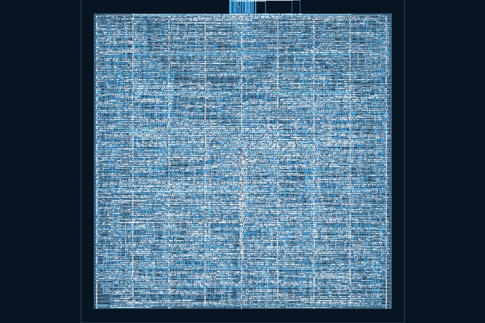

# Managed KLayout Viewer verification — 2026-10-20

The shared dependency path is implemented. This record distinguishes real macOS CPU rendering from offline regression tests and pending native GUI/platform qualification.

## Identity and exercised path

- Harness base: `7a6578e`; owner: [`1117d840e35e521a0db5caf7161935ebc4930535`](https://github.com/Zhiman-BJ/industrial-domain-packs/pull/52), source package 0.5.7, Chip distribution 0.6.3.
- CPython 3.12.15, Astral PBS build `20261013`; exact KLayout 0.30.12 wheel. All four platform asset pairs were independently downloaded and checked against official digest/size metadata by the owner update.
- Actual run: macOS arm64. Production Pack builder → Core-bundled catalog/archive → `PackManager.install(...runtimeScope:'viewer')` → private interpreter and hash-locked local wheel → generic and owner PNG probes → installed-domain resolver → production Desktop dependency host → `RasterService` → real Sobel GDS.
- The production bundle retained its native/container declarations. Viewer-only installation and repair made **zero container preflight/ensure calls**; Viewer readiness did not mark the engineering toolchain ready.

[report.json](report.json) is the host-path-free report from this run. Signed redirect query tokens were omitted from diagnostic URLs. Source `examples/chip-sobel/outputs/sobel_layout.gds` retained SHA-256 `88eb101db90f76a960f5b83e446423b7f8d66fa28240dc1110c49b6ceeabac95`.

| Check                                       | Observed result                                                                                  |
| ------------------------------------------- | ------------------------------------------------------------------------------------------------ |
| Fresh Viewer-only preparation               | 82,068.41 ms; two official resources, three HTTPS requests including the GitHub release redirect |
| Real GDS render                             | `sobel_top`, 22 layers, 1200×800 PNG; source unchanged                                           |
| Repeated render access                      | 50 accesses reused one full dependency resolution                                                |
| Offline full recheck                        | 690.48 ms; zero network requests                                                                 |
| Deliberately delete compiled KLayout module | Viewer changed to needs-preparation; resolver refused the damaged environment                    |
| Explicit offline repair                     | 7,471.05 ms; verified cache reused, PNG probes passed, Viewer ready restored                     |

These are single-run observations, not general performance thresholds. The installer uses a complete private Python tree; no host Python, global pip, source venv or Docker was used by this Viewer path.



## Regression and independent review

- Python manager: 19/19; covers exact downloads, traversal/link/special-file limits, cancellation, local-only pip, relocation failure, persistent needs-repair state, zero-write cache reuse, full repair-space admission and bounded resolution caching. New tests execute on Windows with hardlinks/junctions and the real bounded Node child runner, without new CI skips.
- Pack integration: eight new positive/negative cases; the focused integration/catalog/container run passed 23/23. Viewer-only initial activation, failed replacement preservation, authenticated declaration binding and separate readiness are covered.
- Desktop: 125 tests passed; shared host helper verifies fresh-open resolution, repeated-render reuse, invalid overrides, interpreter replacement and reset. TypeScript/Vite build passed.
- Domain selection/tampered installed-manifest regressions passed 2/2; full architecture passed 48/48; lint had zero errors; release checks passed.
- Astra Ultra independently reviewed the installer and consumer boundary. Its confirmed P2 (failed old probe followed by failed replacement incorrectly restoring ready) was fixed with a persistent repair marker and regression. It also identified the render-path Pack-rescan cost; fresh open now validates fully while repeated render uses interpreter identity. Its independent mid-extraction abort challenge left no recreated staging or uncaught exception.

The complete local portable run executed 1,127 tests: 1,110 passed, 8 allowed skips, 9 failed, no unexpected skips. The failures were unchanged Agent/installer isolation assertions after the local OS sandbox probe was refused, three default diagnostic-log writes outside writable roots, and the existing DMG test whose hdiutil device was unavailable. Owner 0.5.7 does not participate in those paths. The tests and CI allowlist were not weakened; hosted CI remains required.

Owner validation: npm 123 pass / 2 existing skips; architecture 11/11; Chip pytest 29 pass / 6 existing skips; real stdio MCP 25 tools; content-lock, fixed official metadata recheck and npm package inventory passed. Other platforms have verified resources, not native execution qualification.

## Reproduction and remaining acceptance

```sh
node --use-env-proxy scripts/verify-managed-layout.cjs /absolute/path/to/new-diagnostic-output
```

Omit `--use-env-proxy` on Node versions/environments that do not need it. This opt-in diagnostic downloads the pinned resources, builds and installs the consumed Pack into its private output store, renders the real example, deliberately deletes one diagnostic compiled module and repairs it offline. It never modifies user projects or global Python.

The local Electron installation selftest was stopped by the existing macOS GUI service preflight (`bootstrap 1100`); it did not run and is not reported as a GUI pass. Actual file-tree → Viewer UI interaction, settings navigation/language behavior and packaged native flows require their hosted/native checks. This evidence is CPU rendering and dependency preparation, not DRC/LVS or engineering acceptance, and does not close the separate PCB 3D GPU gate.
