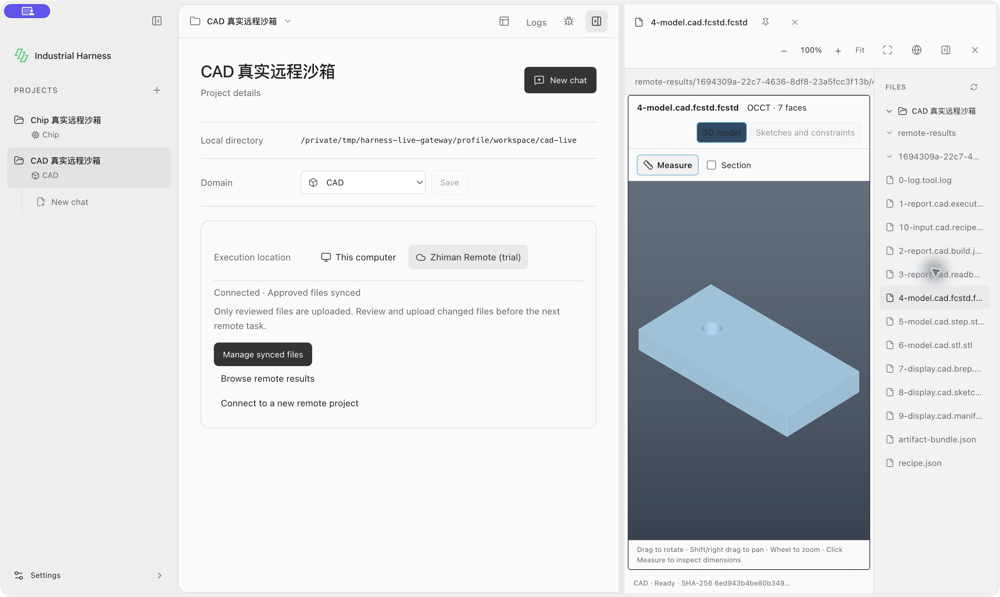
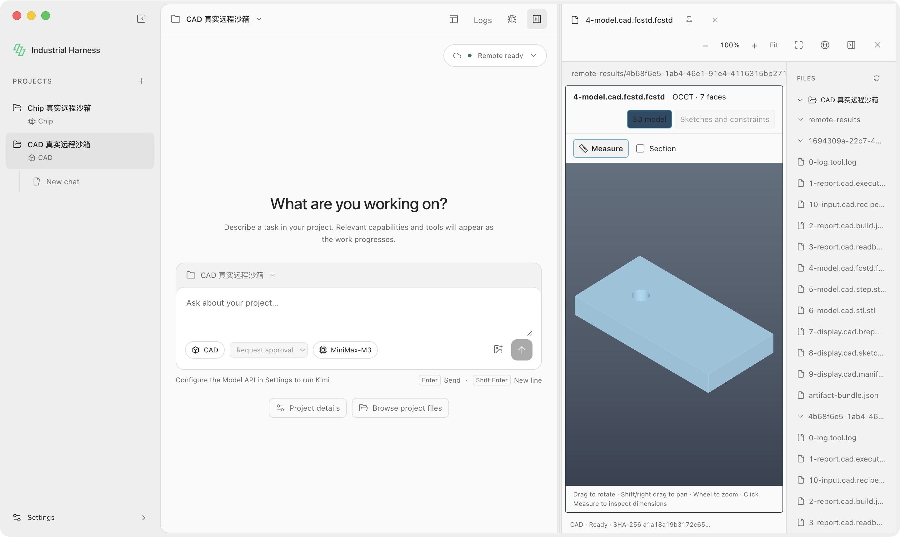

# 远程 CAD 接入与自动释放验收（2026-10-19）

基于当日拉取的 main `4e8cc44`，分支 `codex/remote-cad-20261019` 合并已有当前 gateway 接入后继续实现。远端参考版本为 `industrial-mcp-remote` 的 `a44591c`；实际使用部署服务公布的受保护 inventory 与能力摘要，不从参考代码推定运行成功。

## 实际结果

| 尝试 | 调用结果 | 远程 request | 沙箱释放 |
| --- | --- | --- | --- |
| 首次 | 会话初始化被 `SESSION_QUOTA_EXCEEDED` 拒绝；没有提交工程调用 | 无 | 未创建 CAD 会话 |
| run2 | `cad.freecad.build` completed；`cad.freecad.geometry` passed | `1694309a-22c7-4636-8df8-23a5fcc3f13b` | 自动确认 released；会话 `581018c0-a7f6-4ac4-a8a4-e4e023704f79` |
| run3 | 同一聊天再次 build；completed / passed | `4b68f6e5-1ab4-46e1-91e4-4116315bb271` | 自动确认 released；新会话 `5aa52607-a621-4790-9028-5bcec5250572` |

首次 quota 拒绝保存在根目录的 `attempt.json`、`failure.json`、`cleanup-error.json`。随后通过真实 Desktop 明确结束先前已完成的 Chip 测试会话，才进行 run2；未终止其他活动任务。run2/run3 的聊天 ID 均为 `c4608f46-5b15-435f-a21f-eccbbeca0f79`，使用同一已审核 snapshot。两次 sandbox 自动释放由生产共享 Runtime 触发，验收脚本的 finally 只记录 `automatic: true`，未代替该路径执行停止。

输入是 40×20×5 mm 的长方体，在 (10,10,0) 沿厚度打半径 2 mm 的通孔。独立 FreeCAD 回读得到体积 **3937.1681469282034 mm³**、**1** 个实体、边界 **40/20/5 mm**，FCStd/STEP/BREP 几何一致且尺寸预期通过。每次 11 个远端产物，合计 **22/22** 大小与 SHA-256 重新核验成功；两个历史目录均保留，查看后源字节不变。

每轮的 `result.json` 是共享 Harness 本地规范结果，`receipt.json` 保留源回执，`cleanup.json` 是已确认自动释放记录；`artifact-hashes.json`、`preview-checks.json` 与 `artifacts.zip` 保留核验和可复查的合成文件。归档保留原始字节（包括 FreeCAD 输出空白），解压后可直接复核 SHA-256。通用 `artifact-bundle.json` 只辅助 Viewer 匹配配套文件，不算工程 Artifact 或新增验收事实。

## 工具与入口范围

- 实际受保护发现及描述：`cad.freecad.build`、`cad.freecad.inspect`、`cad.freecad.export`、`cad.freecad.edit`，profile 为 `freecad-linux-cpu`。
- 实际执行验收：两次 `cad.freecad.build`，通过 shared settings → createProjectRuntime → Broker/审批 → MCP → 源 Verifier → 本地持久记录及下载。
- 本轮没有模型推理；诊断入口为 `scripts/qualify-remote-cad.cjs`，接收内存中的正常桌面账号凭据。没有将 Token/API key 写入证据。不把这次诊断宣称为新的 Kimi CAD 对话验收。
- inspect/export/edit 仅验收发现与描述，尚未真实执行。当前服务 describe 仅披露 object 输入 schema，完整参数 schema 仍待远端补齐。

## 真实 Desktop Viewer

macOS arm64 源码 Electron，从实际项目文件树经 Registry 打开远程 FCStd 与 STEP，均为 OCCT **7 faces / Ready**；对应 STL 的有界解析为 **520** 个三角形。桌面工具栏缩放 100%→125%、Fit→100%、画布滚轮 100%→182%、全屏与 Esc 前后保留 182% 已实测。轨迹中的缩放不会修改产物。触控板捏合本轮未单独复测，沿用既有未修改导航实现，不扩大已有平台资格。

全屏截图另见 [cad-fcstd-fullscreen.png](cad-fcstd-fullscreen.png)。这是实际截图，未用生成图片替代工程证据。

## 自动释放行为和边界

仅在结果确定、产物验证完成、对应本地规范事务提交并清除 needsImport 后释放。工程检查未通过但完整证据已保存也能释放；运行中、未知结果和待导入任务保留。归属或 busy 检查不通过不停止；只有同一 session 的 stopped 回应能换下一代连接身份。释放失败保留 completed/failed 工程结果并单独记 pending，下一次调用先确认释放；没有确认就不派发新的工程动作。已释放任务的后续状态刷新不重新占 quota。

当前不是全局空闲清理器。仅发现/描述工具、旧版本遗留或进程异常退出留下的会话仍需要显式结束或服务端 TTL；不回收其他聊天，也不改变用户 quota。这里验证的是当前部署的单沙箱限制下，两次顺序真实执行成功。

## 本地验证

- 专项测试 **46/46**：多工具发现、artifact bundle 边界、CAD 配套摘要、正常/失败释放、同聊天连续执行、post-turn 不重占 quota、未知调用与导入失败保留、busy/归属/停止未确认、关闭连接异常与状态展示。
- 网关、会话、结果服务和架构策略回归 **46/46**。
- IH-ARCH-001 检查通过；Desktop TypeScript/Vite 构建通过（现有大 chunk 提示）；修改代码 ESLint 0 errors / 0 warnings。
- 具体日志见 `targeted-tests.txt`、`regression-tests.txt`、`desktop-build.txt`、`lint.txt`，摘要见 `validation.json`。
- 未运行全仓原生工业门禁、正式打包发行或其他客户端平台验收；几何通过不代表强度、公差或制造验收。
