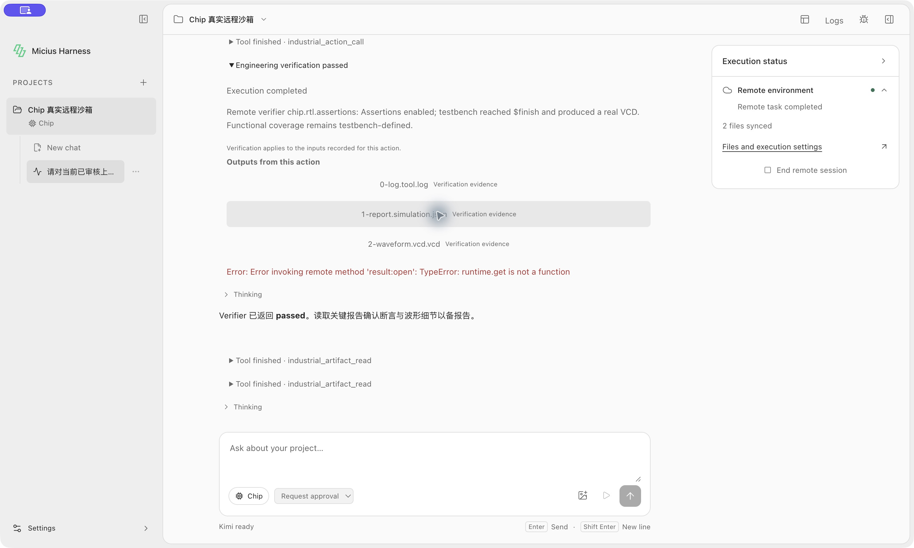
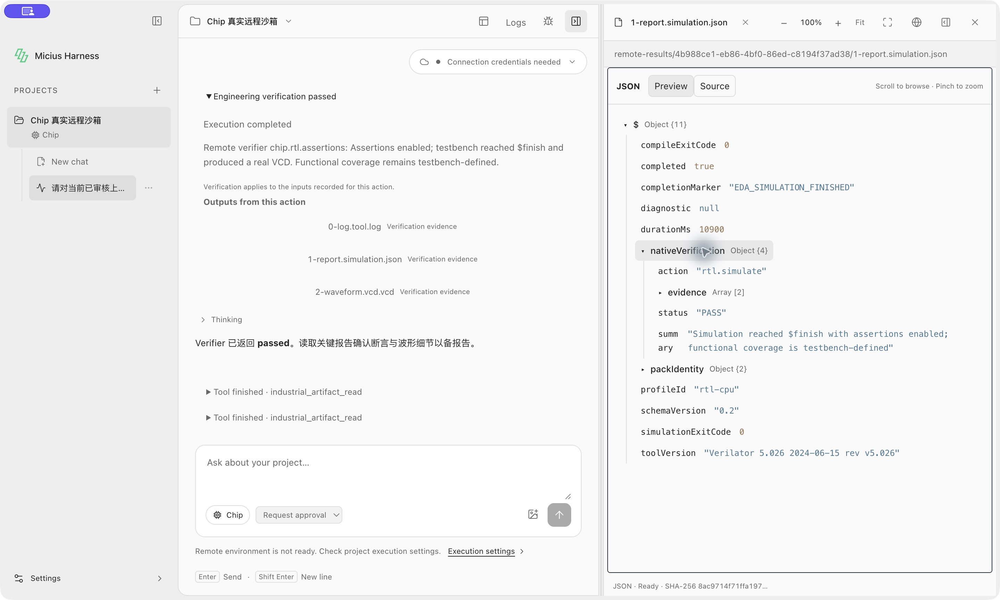
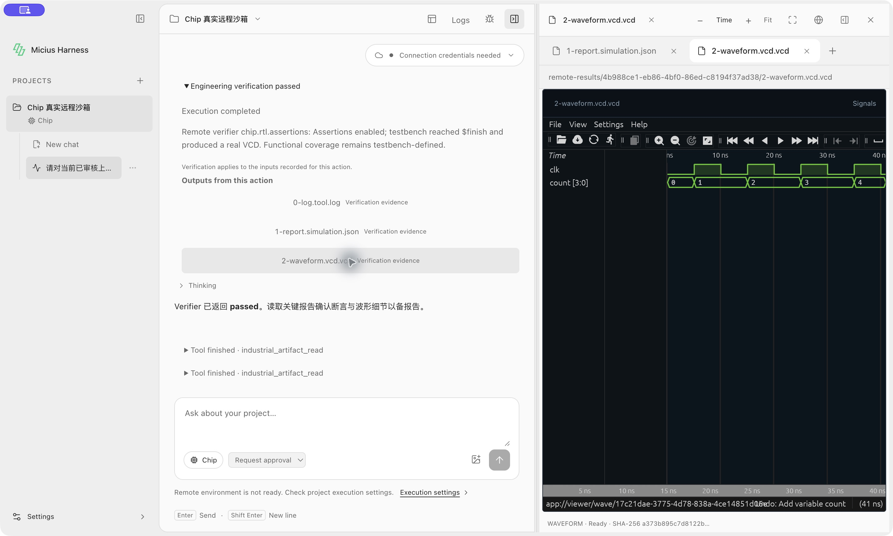

# Remote result opening: Desktop follow-up acceptance

Tested on macOS on 2026-10-17, using the existing MiniMax-M3 run documented in
[remote-chat-20261017](../remote-chat-20261017/README.md). This is a read-only
inspection of that completed execution, not a new model or remote tool run.

Opening the simulation report initially failed with
`result:open: TypeError: runtime.get is not a function`. The remote Runtime
facade omitted canonical record lookup, which is used by result presentation,
artifact metadata lookup and result opening. Historical result access also
attempted to create an execution Runtime instead of using existing records.

The fix forwards `get` and project-binding checks to the remote canonical store.
`TaskService.results` and `openResult` now use a read-only record handle and close
it on success or failure. Recorded chat/turn/Action membership, artifact ownership,
project path containment, file size and SHA-256 checks remain enforced.

## Actual Desktop checks

- Relaunched the test app against the same profile. The UI showed
  `Connection credentials needed`; no new remote computation was submitted.
- Opened `1-report.simulation.json` from the recorded engineering result. The
  embedded JSON viewer reached Ready and displayed native `rtl.simulate: PASS`,
  compile/simulation exit codes 0, duration 10900 ms and Verilator 5.026.
- Opened `2-waveform.vcd.vcd` from the same result. The Surfer viewer reached Ready
  and visibly rendered `clk` and `count[3:0]` through the approximately 41 ns trace.
- Opened `0-log.tool.log`. The text viewer reached Ready and included
  `HARNESS_REMOTE_SMOKE_PASS`, `$finish` and `EDA_SIMULATION_FINISHED`.
- Independently reopened all three artifacts through the shared TaskService API,
  with execution Pack loading configured to throw. Every size/SHA-256 still
  matched the original receipt, and no execution Runtime bundle was created.
  See [result.json](result.json).

The original test process did not finish normal shutdown and was force-quit
before the relaunch. Shutdown behavior is not qualified by this follow-up.

## Regression checks

Before the fix, the added assertions reproduced the missing `get` method and
the unintended execution setup during historical access. After the fix:

```sh
node --test packages/harness-core/tests/current-remote-runtime.test.cjs \
  packages/harness-core/tests/remote.test.cjs \
  packages/harness-application/tests/results.test.cjs \
  packages/harness-application/tests/task-service.test.cjs
```

All 61 tests passed. Coverage includes active/reopened remote canonical records,
historical result opening without remote readiness, wrong chat/group/Action
rejection, and changed bytes rejected by both opening and reveal-only paths.
Architecture contract checker, changed-file ESLint and formatting checks passed.
These are targeted regressions, not acceptance of additional industrial domains.

## Screenshots

Screenshots were captured directly from the real Desktop application. They
contain no model thinking, credentials or account details.

Before fix:



After fix, report from the existing run opens without current remote credentials:



After fix, that run's real VCD renders in Surfer:


