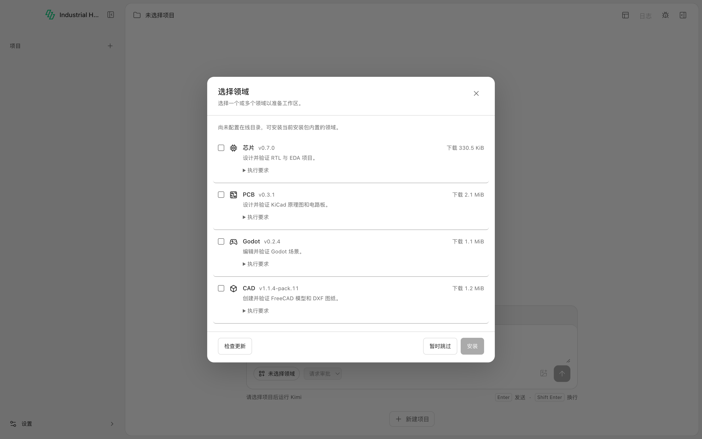
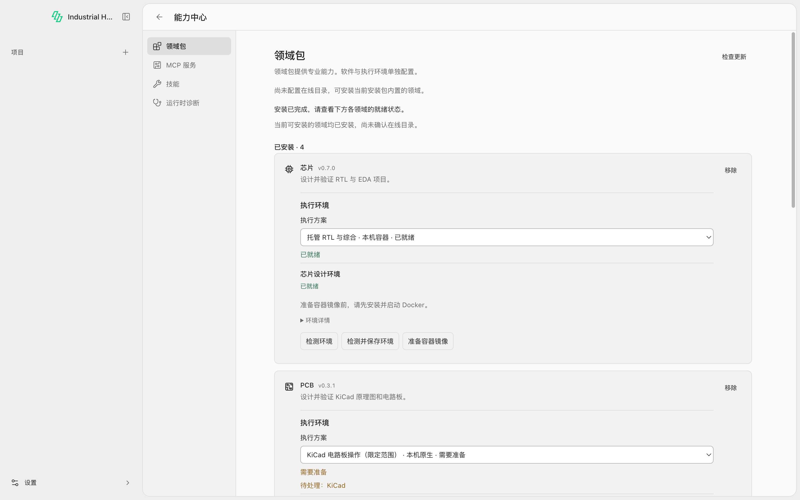
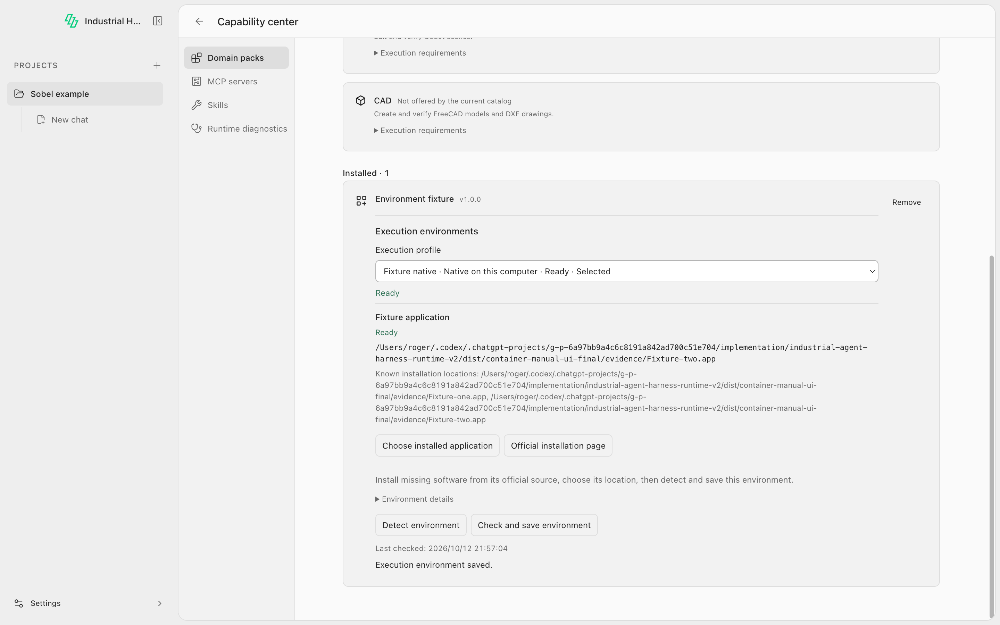
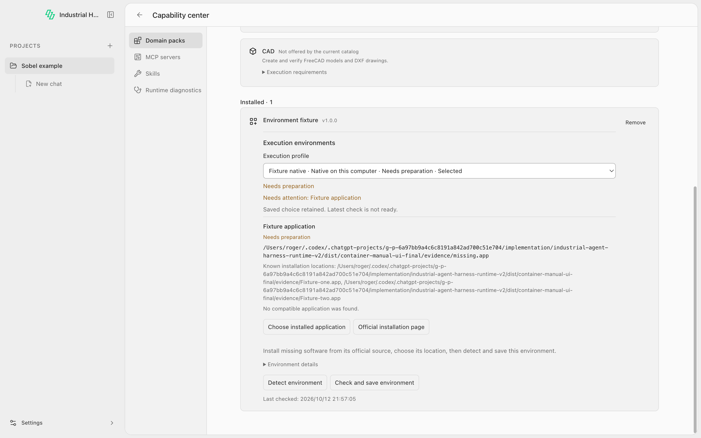

# 共用本机运行层与最终安装边界验收（2026-10-12）

本轮在 macOS ARM64 完成共用本机依赖关联、DXF 本机执行、已安装 PCB 包修复及容器准备入口验收。最终产品边界由 [PD-075](product-decisions.md#pd-075原生软件外部安装与显式容器准备) 确认。复验任务书见 [Agent 安装验收](agent-install-acceptance.md)，原始证据在 [qa-evidence/native-runtime-20261012](qa-evidence/native-runtime-20261012/)。本文报告实际覆盖，不代表 T01–T40 全部通过。

## 最终产品行为

| 对象                               | 谁准备             | Harness 行为                                                                       |
| ---------------------------------- | ------------------ | ---------------------------------------------------------------------------------- |
| Domain Pack                        | Harness            | 下载、校验、安装及更新；不隐式准备任何运行依赖                                     |
| KiCad / FreeCAD / Godot 等原生应用 | 用户从官方来源安装 | 官方入口、检测、选择路径、验证并关联；没有产品内下载、安装或修复软件入口           |
| 独立本机 Runtime / CLI             | 用户或管理员       | 选择目录或可执行文件，固定探针及完整身份验证后关联                                 |
| Docker CLI 与服务                  | 用户               | 检查是否存在、已启动且支持 Linux 容器，缺失时给出准备指引                          |
| 固定容器镜像                       | Harness 可提供     | 用户选择容器方案后显式准备；进度、取消、失败与重试可见，也可关联已备好的同身份镜像 |

Desktop、CLI 和共享 API 执行同一边界：原生 `prepare` 返回 `DEPENDENCY_INSTALLATION_EXTERNAL`，旧 `install(..., {prepareRuntime:true})` 在下载和安装前拒绝。内部归档维护工具不再是原生产品安装路径。旧软件、缓存、收据和工程历史保留。CUDA 远程服务仍退出当前产品目录。

## 源码与产物身份

- Host：本报告所在提交，基于 `c5de8e3fd2c332e0b06e2f2fe2e459cccda12c4f` 的本轮工作树；PR [#130](https://github.com/Zhiman-BJ/industrial-agent-harness/pull/130)。测试时的具体产物见 [build-identity.json](qa-evidence/native-runtime-20261012/build-identity.json)。
- Owner：`1eae41d583bc526c36ae8a8f6c08343504949928`，包 `0.7.0`，content SHA-256 `157d9afd0d9af4b368c439c667140bb2c6969b9bf373eed2da594a47fdde46dc`；PR [#20](https://github.com/Zhiman-BJ/industrial-domain-packs/pull/20)。
- 目录版本：Chip `0.7.0`、PCB `0.3.1`、Godot `0.2.4`、CAD `1.1.4-pack.11`。[实际打包目录身份](qa-evidence/native-runtime-20261012/packaged-catalog-identity.json)。
- DXF 外部 Runtime `1.0.1`：30,141,461 字节，SHA-256 `10ff2481aea0661f6315c803bd14407634f240f77fdcadf80bf1cc709cf07318`。本机验收前在产品流程外解包，产品下载字节数为零。
- Go 固定探针使用本轮 Owner 构建；[组件索引](qa-evidence/native-runtime-20261012/platform-probe-index.json) 绑定源提交、平台、文件大小及 SHA。这不是全部 Domain MCP 的 Go 重写。
- Desktop 是本机重新构建的未签名、未公证 ARM64 `.app`，没有公开发布安装器。实际四域安装使用包内目录与独立 store/config/userData。

## 实测结果

各行证据可能包含于同一自动化套件，不能简单求和当成独立 case 总数。

| 验证                     | 本轮结果                                              | 证据与限制                                                                                                                                                                                                                     |
| ------------------------ | ----------------------------------------------------- | ------------------------------------------------------------------------------------------------------------------------------------------------------------------------------------------------------------------------------ |
| Host portable            | 537 项，536 通过，1 个原有允许的 KLayout 跳过，0 失败 | [机器报告](qa-evidence/native-runtime-20261012/portable.json)；含 71 项 Pack Manager、20 项 CLI、56 项 Desktop 单元及安装布局回归；不代表多平台执行                                                                            |
| 架构 / release           | 47 / 18 项通过                                        | [架构](qa-evidence/native-runtime-20261012/architecture.txt)、[release](qa-evidence/native-runtime-20261012/release.txt)；未扩大 checker、policy 或 workflow 例外                                                              |
| 真正 Electron 环境 UI    | 24 个检查通过                                         | [renderer.json](qa-evidence/native-runtime-20261012/renderer.json)；受控软件 fixture，覆盖原生无下载、文件/目录选择、容器准备、Docker 指引、颜色、失败覆盖旧 Ready、取消、作用域和窄屏                                         |
| 安装交互与退出           | 完整交互 selftest + 下载中退出通过                    | [安装](qa-evidence/native-runtime-20261012/install-experience.json)、[退出](qa-evidence/native-runtime-20261012/quit-during-pack-transfer.json)；下载是 Pack，原生应用由签名 fixture 外部准备；退出等待清理，nativeDownloads=0 |
| Owner 完整套件           | 93 项，90 通过，3 个明确 opt-in 跳过                  | [测试](qa-evidence/native-runtime-20261012/owner-tests.txt)、[content lock](qa-evidence/native-runtime-20261012/owner-lock.txt)；其 native 资格按下述 Host 实测另计                                                            |
| 新 `.app` 中实际四域目录 | 四个 Pack 均可选并安装，0 次隐式环境准备事件          | [报告](qa-evidence/native-runtime-20261012/packaged-catalog.json)；实际 release bootstrap，非 fixture catalog，无模型 API 参与                                                                                                 |
| 真正本机 DXF             | 约 43 秒通过；7 次实际本机执行，无 Docker             | [日志](qa-evidence/native-runtime-20261012/native-dxf.txt)；下文列出成功、失败、取消、篡改与恢复边界                                                                                                                           |
| 真正 PCB design 容器     | 约 25 秒通过                                          | [日志](qa-evidence/native-runtime-20261012/pcb-container.txt)、[报告](qa-evidence/native-runtime-20261012/pcb-container.json)；已有 Docker / 暖镜像，不是镜像冷下载                                                            |
| 真正 Chip / Godot        | 两项通过，约 19 秒合计                                | [日志](qa-evidence/native-runtime-20261012/native-godot-chip.txt)；Chip 显式准备后实际 Verilator / 持久化恢复；Godot 原生任务与绑定路径                                                                                        |
| 旧 CUDA HTTP 协议        | 一项受控 HTTP 兼容测试通过                            | [日志](qa-evidence/native-runtime-20261012/legacy-cuda-transport.txt)；不重新开放产品 CUDA，也不代表 GPU 服务验收                                                                                                              |

本机 DXF 从生产 Pack 安装开始，只关联外部 Runtime 目录，经实际 Project Runtime 创建 40×20 闭合矩形与直径 4 圆，独立回读及正确几何核验通过。错误直径验证失败，负半径产生失败 Action，取消得到真实 `CANCELLED` 后端结果和未通过的 Action；重新打开恢复 checkpoint。修改 Runtime 中的文件后拒绝旧关联，外部恢复文件并重新关联后再次通过。CLI 文件关联额外绑定所选路径、真实目标和哈希，目录关联绑定完整树及模式，不依赖任意 PATH 搜索。

实际 PCB 容器在仓库外的生产安装布局执行创建工程、放置电阻、生成原理图与物理板、ERC、DRC。ERC 为 PASS、DRC 零错误，但整体设计评估仍如实为 UNKNOWN，未将退出码当成工程通过。取消后重新打开保留电路板及 1k 元件。

另有全部 88 个 `pcb.design.*` 工具经过实际已安装 Pack、Broker 和 Project Runtime 分发到受控后端的回归；它证明闭包、清单和分发，不等于 88 项真实工程测试。PCB 和 Godot 的资源校验 helper 现在随 Pack 分发，不再要求源码 checkout 中的 `lib/resources.cjs`。

真实 PCB 测试同时发现并修复常驻工具进程未随 Project Runtime 关闭的缺陷：共享后端会等待正在启动及已启动会话清理，避免取消／重开时仍持有工程锁。进程异常保留有界 stderr 诊断。复核还修复了 Docker 正常警告被当成检测失败、CLI 多候选未关联却返回成功两项问题。

CI 的外部应用前置条件由测试 fixture 消费明确指定的本地归档：固定 size／SHA-256 校验后，离线解包到产品 store 之外，再由产品真实关联接口复验签名、版本和身份。没有本地归档就失败，不回退网络。4 项 portable 负例覆盖缺失、同长度篡改、签名／版本失败及产品目录隔离；workflow 和零跳过要求保持原样。真实 KiCad 10.0.6 已在此路径验收：约 48 秒、零网络请求、关联 Ready，产品 runtime store 未创建；[证据](qa-evidence/native-runtime-20261012/offline-kicad-association.json)明确不计工程任务验收。

## 截图

实际打包应用，四域一行用途、折叠依赖与清晰分隔：

实际打包应用中的容器入口，Docker 与镜像已存在时依赖显示绿色；原生 KiCad 缺失以黄色列出：

以下两张来自受控 renderer fixture，用于验证显示语义，不代表厂商应用已安装：

## 未覆盖与复验要求

- Chip 和完整 PCB design 本机执行仍未实现／qualified；它们继续使用容器。CAD 的 DXF 本机方案已验证，容器方案继续保留。并未宣称彻底移除 Docker。
- 本轮没有完成迁移后的完整 FreeCAD／KiCad 工程端到端用例；真实 KiCad 离线准备与外部关联已通过，但不等于工程验证。独立 QA 使用已安装路径或 CI 明确准备的固定本地归档，产品安装过程不下载这些软件。
- KiCad 原有 1200 秒托管下载缺陷不再阻塞当前原生产品流程。内部传输实现已补足大文件期限、ETag / Range 续传和校验，曾实际完成约 1.4 GB 归档及续传验证；该证据属于撤下的旧产品入口／维护传输层，不计作本轮新用户安装通过。
- 容器测试使用已有镜像；未清空用户 Docker 缓存，不声称冷拉取性能验收。没有新增可运行 Docker 的 macOS CI 实体机。
- 当前报告不代表跨平台 CI 全绿、签名／公证发行、实际远程 GPU 验收或 REA Plan/Doctor 提案全部实施。两个 PR 保持 draft，CI 与独立 QA 按实际 head 复验。
