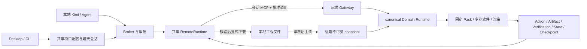

# 远程软件、MCP 与沙箱：v1.1 重构

2026-10-19 更新：当前 `mcp-v1` 路径支持一个 profile 的多个工具：以受保护 inventory 的 Pack/profile/能力摘要绑定服务目录中的 `worker.toolIds`，逐个通过实时 describe 确认身份；拒绝缺失、重复和超限集合。CAD 四工具可发现，真实 build、下载与 Viewer 验收见[证据](evidence/remote-cad-20261019/README.md)。工具输入 schema 仍以远端实际返回为准；当前 CAD 服务仅返回 object，并未完整披露参数约束。

单用户单沙箱 quota 下，当前路径在远端调用结果确定、本地产物与规范记录提交、`needsImport` 清除后自动释放。先核对项目、领域、聊天身份和非 busy 状态，只有服务确认同一 application session 为 `stopped` 才更新持久绑定、生成下一代 client session key。同一聊天的下一次调用重新建立远程会话，已有工程历史保留；任务后刷新不重新占用刚释放的 quota。工程验证失败但证据已完整提交的任务也可释放，运行中、结果未知及待导入任务保留会话。释放异常独立显示 pending，保留已提交的工程结论；后续调用先重新确认释放，未确认时不提交新工程调用。

该自动释放只覆盖当前 `mcp-v1` 任务完成路径，不是全局空闲回收器：仅发现/描述工具而未执行的会话、旧版本遗留会话和进程意外退出仍需服务端 TTL 或显式结束。不会为抢 quota 终止其他聊天，不自动重放工程调用。显式结束的旧行为与历史 canonical gateway 协议不变。

2026-10-17 更新：已用 MiniMax-M3 完成真实 Desktop/Kimi 对话闭环：模型描述并调用
`chip.rtl.verify`，经审批进入远程沙箱，源 Verifier 返回 `passed`，模型读取本次报告并
完成回复。三份产物的大小与 SHA-256、持久化规范记录均已核对。
这是有审批的 Chip smoke 验收；实际过程与限制见
[模型驱动验收记录](evidence/remote-chat-20261017/README.md)。

2026-10-17 故障注入补验：修复准备阶段取消后仍提交、重开忽略待导入结果、以及本地记录
提交前过早清除导入标记的问题。取消信号覆盖工具发现并在执行前复查；已提交请求的停止
仍只中断本地等待。`needsImport` 在匹配的本地规范记录完成提交后才清除，存储或提交失败
时保留。未完成导入会阻止同项目各聊天继续执行、重新上传、切换位置、重绑及替换服务；
发现阶段结束后再次检查，覆盖其他聊天在等待期间发生的导入失败。桌面会提示结果需要恢复。
这次补验使用受控故障注入，未新增真实远程工程调用；仍不提供自动导入修复或未知调用重放。

2026-10-16 更新：已接通当前部署的 `mcp-v1` 契约，并通过真实 Chip 沙箱调用。
该契约的本地规范记录、发现方式和恢复限制见文末；下列历史 canonical gateway
描述中的 grant、服务端 Run/Action/Checkpoint 和 invocation 查询不适用于它。
真实运行证据见 [本轮验收记录](evidence/remote-gateway-20261016/README.md)。

2026-10-13：当前源码将远程执行重构为会话式 Gateway v1.1。**Kimi/Agent 留在本地，专业软件、领域 MCP 和执行沙箱在远端；工程文件显式上传，生成文件显式下载。** 这是本地/远程执行边界的重构，替代原服务 0.2 的 snapshot/job/poll/cancel 客户端链路。

共享客户端、配置、聊天绑定与 Runtime 接入已实现；正式可执行性还取决于服务端安装的 canonical Runtime、固定 Pack、原生软件与隔离平台的实际资格。当前代码和受控驱动测试不构成 KiCad、其他工业软件或生产 Linux worker 的验收。旧 H200 RTL 验证属于旧协议的历史证据，不能沿用为本次 v1.1 资格。

## 用户操作

项目运行位置仍为本机或远程，对话继承项目选择，审批按对话生效。服务由应用/部署配置提供；地址或凭据未配置时，界面明确显示尚未配置。连接成功只证明服务协议可用；远端领域及沙箱后端均有对应资格，才允许正式专业软件调用。

每次上传均有显式文件清单及目的地预览，默认不选文件。用户确认后得到不可变 snapshot；本地文件内容变化后，下一次远程执行要求重新审核并上传，**不再自动同步曾选路径的新内容**。服务端的生成内容以 canonical Artifact 返回；下载时由用户指定项目内相对目的路径，验证大小与 SHA-256，并拒绝覆盖既有文件。下载不会自动合并或替换本地源码。

每个聊天有独立、持久的 `clientSessionId`；重连、重启与同一聊天追问复用它，新聊天使用新身份。远端生成 `applicationSessionId`，将身份、项目、领域和沙箱代际绑定。多个聊天共用项目事实库，但不共用远端聊天身份或调用连接。

当前执行为同步 MCP 调用，服务忙时返回明确的限流/并发错误，不显示旧 job 队列位置。停止本地等待只中断客户端等待，**不表示远端计算已经取消**。会话状态和调用结果可独立查询；“结束远程会话”是显式生命周期操作，运行中的会话可能返回 `SESSION_BUSY`。关闭聊天连接、一次工具完成或服务回收空闲沙箱，不会删除持久工程和产物。

## 共享边界



`harness-application` 的共享任务服务供 Desktop/CLI 使用。`RemoteSettings` 管理服务身份、远端项目与 snapshot；`RemoteGatewaySessions` 管理聊天到远端会话的持久绑定；`RemoteGatewayClient` 使用官方 MCP SDK 的 Streamable HTTP 与 v1.1 文件/状态接口。`RemoteRuntime` 维持 canonical Runtime facade，并将项目事实缓存与聊天连接分开。

远程模式在加载本地领域可执行插件之前分流。本地保留受控工程文件读取/编辑；专业软件的 Runtime、MCP 进程和沙箱由服务部署，不需要客户端本机安装对应软件。Agent 通用 Shell 不迁移到远端，远程 facade 当前不提供 `project.task.run`。普通外部 MCP 仍是未验收观察，不能绕过 Broker 与受保护的 Runtime 入口。

服务端只接受固定部署提供的 canonical Tool ID。模型使用领域工具发现/描述/调用入口，宿主自动附带聊天、远端项目、snapshot、expected State、能力摘要和审批 grant。服务端逐项复核授权，然后由 owner Domain Runtime 产生工程事实；工具文本、HTTP 成功和原生进程退出码都不能取代工程 Verifier。

## 文件、身份与恢复

- 服务连接固定 URL、`serverId` 和凭据身份。凭据只由宿主读取，不进入模型、Renderer、snapshot 或调用 journal；服务凭据环境变量从 Agent 环境排除。
- 正式服务使用 HTTPS，开发允许 loopback HTTP；拒绝 URL 内嵌凭据和自动重定向。
- 上传限制为 1–256 个文件、总量不超过 8 MiB，排除路径穿越、符号链接、硬链接、私钥和常见凭据路径/字段。预览绑定目的地、项目和文件摘要，五分钟后失效，期间文件变化需重新审核。
- 输入文件在服务端核验并冻结，软件输出以产物返回。修改本地工程后，旧 snapshot 的通过记录仍是历史证据，不能证明新内容。
- 每次调用在发出 grant/MCP 之前持久保存 invocation ID；恢复按该 ID 查询。断线、超时或查询 404 均不能证明未执行，不自动重放可能发生过的调用。
- 只有服务明确报告 `retryable` 且 `outcome: not_submitted`，客户端才进行有界重试。未知结果需要先确认，不能切到另一服务/本机重新执行同一操作。
- 下载前验证 canonical 身份、产物大小和摘要。结果导入保留服务端原始 Action/Run/Verification/State/Checkpoint 身份；本地只读 CAS 与用户选择的工程下载路径分开。
- 同聊天调用串行；服务端控制项目并发、会话 busy、固定沙箱数量与准入。沙箱重建使用新 generation，停止未确认的 lease 不释放容量。

目录独立不是 OS 沙箱资格。远端未配置真实隔离 profile、原生软件未验收或默认使用测试适配器时，服务应公布 `unqualified`/测试状态并拒绝正式执行 grant。客户端连接检查展示连接能力与可执行领域，不将可发现的工具等同于已就绪的软件。

## 服务配置与旧版本迁移

`packages/harness-core/src/remote-defaults.json` 的公网 service URL、凭据环境变量名与 login URL 默认均为空。`loginUrl` 仍为后续认证预留，当前不发起 OAuth 登录。模型 API 配置与远程执行服务配置相互独立。

服务运维可在 `INDUSTRIAL_HARNESS_CONFIG_DIR/remote-settings.json` 的 `service` 中提供 `serviceUrl` 与 `credentialEnv`，或使用 `INDUSTRIAL_REMOTE_SERVICE_URL` / `INDUSTRIAL_REMOTE_CREDENTIAL_ENV`。后者指定承载令牌的宿主环境变量名称，令牌本身不写入配置文件或仓库。首次检查固定 `serverId`；更换服务/凭据不会把旧项目自动转投新身份。

配置文件可读取原 schemaVersion 1 并以 schemaVersion 2 保存，但这只是配置容器兼容，**不迁移服务 0.2 的项目、job、grant 或运行中任务**。已有旧 `remoteProjectId` 缺少 v1.1 绑定时会拒绝复用；不能通过手改 `protocol` 字段冒充兼容。

`remote rebind` 提供显式的新项目绑定入口：默认只展示意图，不请求网络或改写绑定；加 `--confirm-new-project` 后，检查当前配置的服务身份并新建 v1.1 远端项目，两步成功才写入新绑定。当前项目的旧完整绑定与服务配置（无令牌）保存在 `bindingHistory`，其他项目绑定保持原值。新绑定没有 snapshot/文件清单，必须另行审核上传；旧 canonical 历史、job 和产物仍归旧项目，不迁移或删除。

重绑会检查旧服务身份对应的 v1.1 invocation 和 0.2 job journal，存在运行中或未知任务时拒绝操作。先向旧服务确认这些调用，再创建新绑定；更换服务不是重放未知操作的方式。服务 `serverId` 变化也只能通过此显式流程接受，不会在普通连接检查中自动覆盖。

新客户端要求服务声明 `remoteProtocolVersion: "1.1"`、`canonicalSchemaVersion: "1"`、稳定 `serverId` 和 `sessionModel: "application-session"`。仅有旧 v1 会话 MCP 入口而没有 snapshot、grant、canonical result 和产物下载契约的服务，也不能承担正式远程执行。

## CLI

以下为已实现命令。`DOMAIN` 与各 UUID 替换为实际项目及查询得到的身份：

```sh
industrial-harness remote status
industrial-harness remote connect
industrial-harness remote use --project-dir /path/to/project --domain DOMAIN --location remote

# 首次项目由 sync 建立绑定；旧协议或更换服务时先预览并确认创建新远端项目。
industrial-harness remote rebind --project-dir /path/to/project --domain DOMAIN
industrial-harness remote rebind --project-dir /path/to/project --domain DOMAIN --confirm-new-project

# 只预览；确认过内容后再加 --confirm-upload 执行上传。
industrial-harness remote sync --project-dir /path/to/project --domain DOMAIN --file project-file
industrial-harness remote sync --project-dir /path/to/project --domain DOMAIN --file project-file --confirm-upload

industrial-harness run --project-dir /path/to/project --domain DOMAIN --task '执行已授权的远程领域任务' --approval approve
industrial-harness chats --project-dir /path/to/project --domain DOMAIN
industrial-harness remote session --project-dir /path/to/project --domain DOMAIN --chat-id CHAT_UUID
industrial-harness remote task --project-dir /path/to/project --domain DOMAIN --chat-id CHAT_UUID

industrial-harness remote artifacts --project-dir /path/to/project --domain DOMAIN
industrial-harness remote download --project-dir /path/to/project --domain DOMAIN --artifact-id ARTIFACT_UUID --destination results/output-file
industrial-harness remote terminate --project-dir /path/to/project --domain DOMAIN --chat-id CHAT_UUID --session-id APPLICATION_SESSION_UUID
```

`run --chat-id CHAT_UUID` 用于已有聊天追问，复用该聊天的远端连接身份。`remote session` 只读查询应用会话，`remote task` 查询上次调用的持久结果；显式结束后，该远端会话不再恢复，后续工作需新聊天身份。旧 `remote cancel` 已移除。Ctrl-C/任务停止不会发出未实现的远端取消承诺；用调用查询确认结果，再决定后续操作。

`--scope-only` 继续是静态能力预览，不连接服务或创建执行权限。

## 验证与仍待验收项

当前专项测试覆盖会话身份隔离/重连、凭据隔离、HTTP/JSON-RPC/MCP 错误、busy/限流、已知未提交的有界重试、未知结果不重放、显式上传、受控下载、canonical 事实/产物验证与 Scope/审批拒绝。远端测试另外使用真实 owner `IndustrialRuntime` 与固定的受控文件驱动验证上传→执行→canonical result→产物字节闭环；该驱动无工业验收能力，结果保持 `not_run` / `unverified`。

本次实测环境为 macOS、Node 26.10.0。本地真实 PostgreSQL 16、S3 兼容对象存储和 Flyway V1/V2 迁移已参与双仓联调，`RemoteSettings/createProjectRuntime → HTTP/MCP → owner Runtime → 结果导入/产物下载` 及重启后查询恢复共 36 项通过。这证明本地持久化与客户端/服务端协议闭环；执行驱动仍是受控 fixture，不是 KiCad 或其他专业软件验收。

Desktop TypeScript 检查、构建及真实 Electron UI 自测通过，覆盖未配置状态、页面切换和无自动上传。客户端远程、Runtime 与共享应用测试通过；全套源码测试中，既有 CLI `stable portable Pack registration` 测试因缺少 `HARNESS_PLATFORM_PROBE_INDEX` 失败，另有 3 项平台相关测试跳过。因此不将本轮描述为全部仓库/平台测试通过，后续新增测试的计数以最终测试输出为准。

仍需分别验收目标部署的 KiCad/Verilator/其他 Pack、实际隔离后端、原生软件依赖与 Linux worker、生产环境持久化/恢复、真实 Desktop/CLI 到服务的专业软件闭环，以及公网认证/登录。本地 PG/S3 集成、新源码测试与历史旧协议 RTL 记录均不代替这些资格。


## Current MCP gateway adapter (2026-10-16)

The `mcp-v1` service-info contract is selected separately from the historical canonical
gateway protocol. Project IDs are bound to the service/account; Harness derives a local
canonical project ID when the service does not return one. Each chat retains its own
client session key. Execution goes through the shared factory and existing Broker and
approval gate. Inputs are uploaded only after review. Local records wrap the actual
remote receipt rather than pretending that the server supplied Run/Action/Checkpoint.

A matching login access-token audience uses normal refresh; a different service audience
still requires resource exchange. All requests resolve credentials at dispatch and check
the bound subject again after token acquisition. Tokens never enter model arguments.

Current-service execution availability is checked by protected tool discovery when a
chat connects. A metadata-only discovery response binds the catalog hash, Pack and active
profile to its bounded worker tool list; the live runtime must describe each exact tool. A static
catalog entry alone does not establish executable/native support. The UI permits this
discovery after sync and displays service failures when discovery rejects.

The 2026-10-16 real run used desktop Obol login and the shared settings/Broker/Runtime,
created an application session and Tencent sandbox, and executed `chip.rtl.verify`.
The source `chip.rtl.assertions` verifier passed; three downloaded artifacts matched
their recorded hashes. Local Run/Action/State/Checkpoint records reopened unchanged,
and the Desktop project page listed the outputs and downloaded the VCD successfully.
This was an explicitly approved diagnostic with no model inference, not a completed
Kimi conversation or qualification of other domains.

On 2026-10-17, the actual Desktop composer additionally completed a MiniMax-M3
conversation through pinned Kimi Code 2.1.1 and the same shared task/Broker/Runtime
path. A fresh application session/sandbox lease executed `chip.rtl.verify` once
after operator approval. The source verifier passed; the model read the fresh
report/log and finished its response. Reopened canonical records and all three
artifact hashes matched the received tool result and remote receipt. See the
[conversation evidence](evidence/remote-chat-20261017/README.md), including the
rejected Shell attempt and corrected file-read schema error. CLI live model
execution and other domains remain untested by this case.

Known limits: no current-service invocation status endpoint, no automatic unknown-outcome
replay, no automatic incomplete-import repair, and remote artifact listing covers only
locally recorded results. The live verification helper has no model inference.
