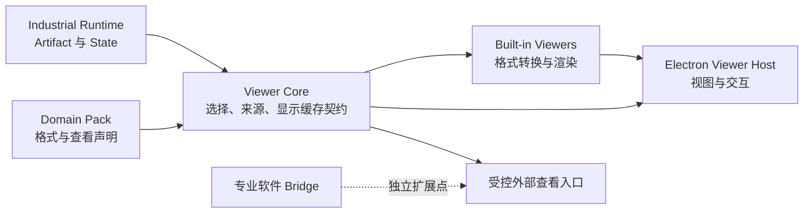

# Viewer 层设计与约束

Viewer 层让用户在 Harness 内直接检查工程产物，并保持产物来源、运行状态和验证结论可追溯。它服务于人工理解与跨视图分析，不替代专业软件的完整工作台。本文定义 Viewer Core、内置渲染器和 Electron Viewer Host 的边界；三种 EDA Viewer 已接入桌面 MVP，Godot Web Export Viewer V1 与 PCB domain 的 KiCad 板图/原理图 Viewer 已在 macOS Electron 实测；边界见 [Godot Viewer V1](godot-viewer.md) 与 [KiCad Viewer V1](kicad-viewer.md)。

## 展示策略

| 场景 | Harness 内部展示 | 专业软件承担 |
| --- | --- | --- |
| 芯片设计 | 波形、Yosys 网表、报告、DEF/GDS 局部版图、层与对象选择 | 完整版图编辑、工艺设置、复杂时序或物理调试界面 |
| PCB 设计 | 原理图或板图关键视图、层、网络、DRC 标记、制造产物预览 | 完整布线、封装编辑、设计规则配置 |
| CAD/CAE | 模型缩略图或受限 3D 预览、剖面图、网格、仿真结果与报告 | 参数化建模、装配、求解器配置和专业后处理 |

CAD 已接入官方开源 OCCT 7.9.2 AIS/V3d/TKOpenGles WebGL2 Viewer，支持封口剖切、面/边选择、名义几何测量和来自原生回读的草图/约束查看，显示经过哈希检查的 Pack BREP/STL 产物，并沿用文件树、共享导航和全屏。实际格式、限制、完整源码与平台证据见 [FreeCAD CAD Pack](freecad-domain-pack.md)；Viewer 的显示不更新工程验收。
| Godot 等复杂 UI 应用 | Godot Web Export 运行视图、场景树、选中节点检查、基础运行控制；其他应用为场景快照、资源预览、日志与测试结果 | 完整场景编辑器、动画工作台和原生运行调试器 |

这些是产品目标，不代表格式支持已经实现。是否内置某种格式，由可获得的解析器、许可、跨平台能力、性能和真实产物验证共同决定。无法可靠内置时，提供可追溯的关键产物预览或明确的外部打开入口。

## 组成与依赖

- **Viewer Core** 只处理查看器描述、能力选择、产物绑定、状态和派生显示缓存。它不依赖 Kimi、MCP、Electron 或具体领域。
- **Built-in Viewers** 实现被选格式的读取与显示转换。复杂或不可信格式在受限进程中解析，向 UI 返回有限的显示数据。
- **Desktop Viewer Host** 负责标签页、视口、图层、时间轴、选择与加载反馈。Renderer 通过窄 IPC 读取显示数据。
- **Domain Pack** 声明本领域的产物类型、配套输入和 Viewer 贡献，但不能向 Electron Renderer 注入任意 HTML 或脚本。
- **Bridge** 负责连接正在运行的专业软件；外部应用启动也是受控动作。两者均不被内置 Viewer 隐式执行。

`packages/viewer-core` 已有初始类型契约和最小 Plugin Registry，`packages/viewer-builtin/src` 提供 EDA、Godot、KiCad、素材、[Godot/PCB 工程文件预览](engineering-file-viewers.md)与通用文件 Viewer。通用文件插件不绑定 Domain，作为专用识别后的格式回退；CSV/TSV、JSON、JSONL、Markdown 和 TXT/LOG 的支持范围与上限见 [通用文件 Viewer](document-viewers.md)。Electron 主进程负责受控文件访问和插件打开，桌面 UI 在文件画布中展示 Viewer。具体 API 会在真实产物链路中继续稳定。

## 最小查看契约

Viewer 请求至少引用 `projectId`、`artifactId`、`stateId` 或 `runId`、查看模式及必要的配套产物 ID。来源记录至少包含产物类型、内容哈希、生产 Run/State、转换器身份和显示参数。调用者不能只传任意绝对路径，也不能从“最新文件”推断历史页面的来源。

Viewer 描述至少说明：稳定 ID、可处理的产物类型、所需配套输入、支持的平台、显示模式、资源上限及可用性。能力探测须区分“未检查”“可用”“不可用”；缺少本机图形环境或软件不等于产物无效。

查看状态需分别表达：等待、加载中、已显示、格式不支持、缺少配套输入、转换失败、资源超限和外部启动失败。外部程序的 `LAUNCHED` 只表示进程已启动；内部 `RENDERED` 只表示显示数据已生成，两者都不改变 Verification。

## 安全和证据边界

1. **只读原始证据**：Viewer 从已登记的 Artifact 读取经身份校验的数据。交互产生的视口、图层、光标和筛选状态只属于 Viewer 会话。需要修改设计时，走明确的 Action/Tool 路径。
2. **派生数据独立**：缩略图、索引、切片、几何瓦片和 SVG 视为显示缓存。缓存键包含全部源哈希、配套产物哈希、转换器版本和参数；缓存失效或失败不能改变原始 Artifact、Run 或验收。
3. **来源清晰**：同一视图的多个产物必须明确是否属于同一 State、Run 或设计对象。跨视图联动只能基于显式映射或可说明的推断；无映射时显示缺失，不虚构网络、信号或几何对应关系。
4. **受限解析**：对大文件采用分页、时间窗口、层级或视口加载。限制输入大小、内存、耗时、输出大小和并发；解析失败给出可诊断错误。SVG、HTML、项目文件和插件内容不得以可执行脚本直接进入 Renderer。
5. **受控外部应用**：打开 KLayout、KiCad、CAD 或 Godot 等应用需显式用户动作或明确授权；传入核验后的导出副本和参数数组，不拼接 shell 命令。应用启动、文件加载和工程验证分别记录。
6. **权限与隔离**：Electron Renderer 不持有任意文件系统、Node 或进程权限。第三方 Viewer 贡献不能直接执行 UI 代码；若将来支持交互插件，需独立沙箱、来源隔离与受限消息接口。
7. **平台一致性**：每个 Viewer 报告真实的平台可用性。不能因 macOS 可用就宣称 Linux/Windows 可用；无内部查看能力时可展示元数据和明确的降级路径。

## 首批验证顺序

先以真实报告、波形和 Yosys 网表验证只读产物链路及来源显示，再接 DEF/GDS 的按视口展示和 PCB 关键产物预览。Godot V1 在隔离 iframe 中运行 Web Export，不重建完整编辑器；具体接入与限制见 [Godot Viewer V1](godot-viewer.md)。每项格式都需分别验证正常、缺配套文件、错误格式、超限、跨项目引用和缓存失效场景。

现有 EDA Harness 的 `viewer_capabilities`、`open_viewer` 和 Silicon Lens 的波形、网表、GDS 视图可作为设计参考；实现需重新确认许可证、格式兼容性与三平台行为。

## 已迁入的 EDA 参考实现

[EDA Viewer 参考实现](viewer-eda-reference.md) 介绍正式代码路径中的版图、网表和波形 Viewer：KLayout `LayoutView` 按视口渲染，netlistsvg 对 Yosys JSON 生成 SVG，Surfer WASM 在隔离的本地页面中加载 VCD。三者作为实际使用的内置 Viewer，也为新领域接入提供参考。

桌面 Host 目前只将项目文件树中选中的受支持文件登记为 Artifact ID，计算并显示 SHA-256，打开时复核内容哈希。普通文件继续显示文本预览；Viewer 测试 fixture 不会作为产品入口出现。项目、Run、State 的持久绑定及完整来源链仍待 Domain Runtime 接入。Surfer 的底层 WASM 是未修改的官方站点快照；桥接使用的部分消息命令被上游标为不稳定接口，升级时需单独验证。

## 版图 2.5D 示意层叠

GDS/GDSII 与 OAS/OASIS 通过文件树 → Registry → KLayout Viewer 打开，默认二维。立体模式固定进入时的二维 ROI 和共同世界坐标，先逐层显示真实源栅格概览，再由相机和缩放决定局部精确 tile；在立体中继续放大会触发新的细节请求，不自动改变 ROI。概览、精确、空区域、加载、失败及延后细化有不同状态。密集 tile 超出精确预算时保留概览；概览自身失败则明确报错，不用缺少数据冒充空几何。

图层按源 layer/datatype 独立显隐、选择和隔离，包括未知用途层。右侧检查器、画布拾取、穿透高亮及“在二维对比所选层”复用这一身份；拾取区分概览像素与精确几何，选择仍只是图层，不是器件或网络。Top / XY 与 ROI 坐标/微米尺寸便于对照二维；旋转、Shift 平移、共享缩放/Fit、wheel/pinch、全屏/Esc 保留各自视图状态。Z 层序、厚度与间距都是示意参数，不提供 PDK 物理尺寸、金属/通孔语义、连通性或签核。

当前以源 bbox 锚定空间分块，按可见层和反投影视域选择 tile；所有层先请求概览，局部精确请求超过前端工作集时优先细化选中层，其余保留概览并显示延后原因。按优先级逐个加载/解码/上传，generation 取消和丢弃过期响应，缓存按 LRU 释放；隐藏视图停止请求、卸载释放资源。原生裁剪不能保证即时取消，超时可终止 worker，再从同一快照恢复。

### 身份、预算与剩余限制

源在打开时流式复制并哈希，必须匹配登记的 Artifact；私有只读快照绑定项目和活动 token，tile 前后核对源/快照身份，变更须重开。Renderer 不提供任意路径。普通项目文件不再每 tile 扫描大源文件两遍；recorded result 仍调用共享 TaskService，保留聊天、Action/Run、结果组、配套文件及内容哈希校验，因此该路径仍有额外成本。Viewer 不改变文件、DomainState 或 Verification。

| 保护范围 | 当前值与边界 |
| --- | --- |
| 输入与快照 | 单源 128 MiB，快照存储每进程 256 MiB；关闭旧 worker 后再导入，避免切源时主动保留新旧数据库。仍完整加载 KLayout 数据库，没有磁盘分页/外存索引 |
| 精确 tile | 2000 次图形出现、50000 源点、单图形 10000 点、20000 三角形、2 秒协作检查；单大多边形仍可能只显示概览。tile 超时 8 秒；仅在已有真实概览时可用其回退 |
| 前端驻留缓存 | CPU 128 MiB、GPU 64 MiB、250000 精确三角形的计账上限；预算拒收保留概览。此值不包括全部进程/驱动开销，也不是应用总 RSS 上限 |
| 后端 | 响应缓存 64 MiB、排队最多 32 项、单 tile 响应 16 MiB；导入超时 120 秒。旧整 ROI 几何 API 保留原 5000/80000 预算，不作为新视图的全量加载路径 |
| Worker 内存 | 768 MiB RSS 软监控；外部进程采样不可用时使用受支持平台的 worker 自报峰值与边界检查；不是 OS 硬内存隔离，原生操作可能先产生峰值。无法提供有效资源检查时明确不支持 tile 路径 |

精确网格采用 tile 中心局部 Float32，逐帧用 CPU 双精度计算相对 world focus 的偏移；概览沿用同一焦点。缩放和 LOD 受 dbu 网格约束，最深 30 级，不能区分的数值边界降级；缩放、旋转、Top、层间距与 resize 保留世界焦点，Fit 重置。

固定依赖为 KLayout Python 0.30.12 与 WebGL。当前实现没有 cell mesh/GPU 实例复用、外存导入或已验证的超大输入支持；文件不大也可能因复杂多边形、层级或原生解析峰值超预算。远端处理未接入，不上传源文件。进一步的资源/几何约束和阶段 Gate 见 [大版图方案与阶段记录](layout-large-designs.md)。

### 验证范围

[本机后端验收报告](evidence/layout-streaming-20261019/tile-stress-report.json)、[固定 fixture 清单](evidence/layout-streaming-20261019/fixtures.json)及[摘要](evidence/layout-streaming-20261019/summary.json)保留实际结果。

本次流式修订的构建与单元检查已通过，覆盖快照身份/生命周期、有界缓存/调度、LOD 与几何等路径；本机生产后端的 301 次请求验收已通过，包含 192 次 tile 顶面 XY 对照与 64 次接缝检查，均无差异或假墙；缓存、新 generation、陈旧请求撤销、单 worker 及源 SHA-256 保持通过。浮动原点、网格深度与焦点保持的纯前端回归 25/25 通过；实际 HTTP 生产 Host 链路已通过 metadata（32 层）→ cancel → overview → detail，首层 detail 返回 66 个三角形。HTTP 链路不等于 GPU/界面验收；Chrome 实际 WebGL 预览和新版原生 Electron 验收仍待执行。测试输入包括 32 层、9961504 次逻辑图形出现的层级 fixture、262144 个展平图形和 12002 点单多边形；这些是概览与局部精确请求的测试输入，不代表全量三角形已加载或容量资格，也不构成吞吐/FPS 承诺。

历史证据：2026-10-19 macOS 26.5.1、开发态 Electron 44、KLayout 0.30.12 的旧整 ROI 路径通过真实 Sobel 文件树→二维→立体、共享导航/全屏、旋转/平移、图层、WebGL 丢失后的二维回退及恢复，源 SHA-256 不变。该证据先于本次流式和选择修订，不能替代新版验收，也不扩大安装包或其他平台资格。

[Sobel 原始局部审计](evidence/layout25d-geometry-20261019/sobel-geometry-audit.json)逐层核对四个区域顶面 XY 与源 Region，缺失/多出面积为 0；15 µm 区域按层审计，不是组合全量加载。`235/0` 在这些区域覆盖全部范围，可能遮挡其他层，其用途未知，保留原层号供独立选择。新的合成 fixture 精确 tile/接缝对照已单独通过；这仍不代替所有真实大设计的资格验证。

## 自有控件的展示语言

Desktop 使用 `viewer-builtin/canvas` 打开 Registry 已选择的 Viewer，并通过通用的 `viewer-builtin/text` Context 传入展示翻译与语言。`text` API 仅依赖 React，不选择 Viewer、不导入 Desktop/Kimi/工业状态/Runtime，也不改变输入和命令。Desktop 的 `i18n.config.json` 集中声明语言及 Desktop/Viewer 的自有译文，语言偏好属于 Desktop，Viewer 仅消费回调；边界门禁允许这两个通用展示入口，继续禁止直接导入具体 Viewer 做分派。切换语言更新已挂载的自有控件，保留缩放、选择和运行时状态。范围、配置维护及生产路径验证见[桌面语言切换](desktop-languages.md)。

## 桌面标签页布局

DesktopViewerHost 支持可切换的两列与标签页布局，多个文件使用同一 ViewerCanvas 和注册入口。已访问的 Viewer 在隐藏标签或更换布局时保留挂载；关闭文件或项目切换执行正常清理。只有当前文件绑定共享导航工具栏，布局和显示器变化不写入工程事实。窗口响应规则与验收见[自适应窗口与标签页](desktop-layouts.md)。

## 任务成果入口（PD-067）

已实现的成果打开共用 TaskService 的内容绑定解析，再交给 Registry 与既有工作区；未分组的旧 Action 保留文件入口。只有显式允许的只读插件可对前台唯一候选自动打开一次；历史回放、后台、失败或用户已改变焦点只更新卡片。源文件与 companions 全部按记录核对，不以预览成功改写检查。行为与 macOS arm64 源码态验收见[任务成果](task-results.md)。

PCB 的二维和三维模式保留同一 KiCanvas 场景，三维读取固定 painter 的真实显示几何并沿用源对象标识，不引入工业程序执行。层间展开仅为视图状态；封装实体、复杂 padstack 和预览完整性边界见 [PCB 三维](pcb-3d-viewer.md)。
